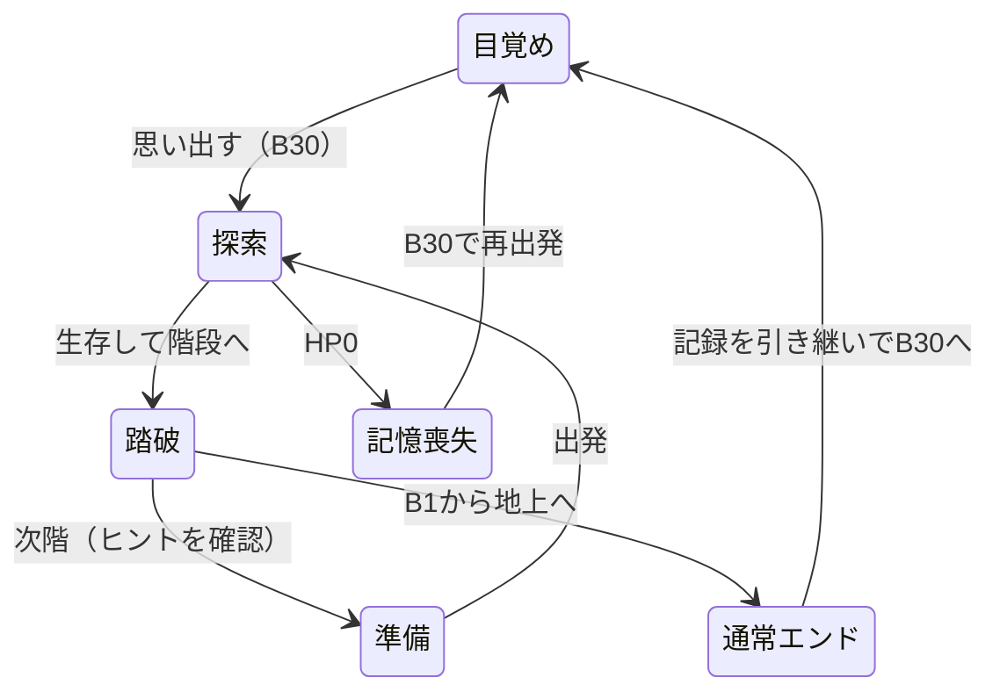

# 骸の旅路 ― システム設計書

## タイトルと上部HUDの共通化（2026-10-27）

タイトルはエンジンphaseと分離した一時状態showingTitleで表示し、起動時はtrue。保存状態は読み込んで保持し、LoadGameでshowingTitleを解除する。タイトル中はループでtickせず、renderから自動保存しない。有効な保存の存在はhasSaveで管理し、NewGameは上書き確認後にnewGameへ進む。タイトルへ戻る場合は停止して既存状態を保存する。

opening.jsのopeningVariantがprofile.trueEndingから版を選び、app.jsがHTMLの画像data属性にある配信URLを参照する。初回は選択した背景とロゴのdecode完了も待ち、起動時の旧UI非表示を維持する。update-assets.jsは4画像にもバイナリの内容ハッシュを付ける。保存v11のprofile.trueEndingを真偽値で検証し、旧保存はfalseを補完。デバッグでのみ切替可能とし、ascendの通常エンド処理は変更しない。

上部HUDはbody:is(.preparing,.exploring) #hud-topの共通ルールで文字・バー・アイコン・レイアウトを定義する。ResizeObserverがHUDの実測高からworkspaceの--shared-hud-spaceを更新し、準備パネルがHUDに重ならないようにする。

## 初回描画の公開タイミング（2026-10-27）

index.htmlのhtmlにdata-startupを付け、外部CSSより前のインラインCSSで読み込み表示以外の要素を隠す。opacityとvisibilityでレイアウト寸法を残し、保存読込・renderScreens・Canvas描画・ResizeObserverの計算を隠れた状態で実行する。インラインのmoduleスクリプトがimport map経由でapp.jsを動的importし、成功後に2回のrequestAnimationFrameを待ってdata-startupと読み込み表示を解除する。外部スクリプト取得失敗もcatchし、再読み込みボタンを表示する。保存形式とapp.jsの状態復帰処理は変更しない。

## 図鑑・デバッグのスクロール領域（2026-10-27）

codex-dialogとdebug-dialogをscroll-dialogとして共通化する。閉じるボタンをdialog-toolbar、既存本文をdialog-scroll-contentで囲み、開いたdialogを縦方向flexにする。外枠のoverflowをhidden、本文のmin-heightを0・overflowをautoにして、高さ85dvh内で本文のみをスクロールする。44px角の閉じるボタンはスクロール領域の外側に置く。既存ID・data-close・イベント委譲は維持し、JSの閉じる処理や保存形式を変更しない。

## 物語文章と表記（2026-10-27）

story-text.jsが初回と通常エンド達成後の回想、開始時の思考、B15の思考を定義する。game-engine.jsは既存のプロフィールnormalClearsを参照し、同じ階クリア時に文章を保存する。app.jsは旧回想・ログ・保存済み次階ヒントを表示時に変換し、元のv11データは変更しない。階層名は既存zone IDを保ちdata.jsの表示名だけ変更する。旧50階共闘は現行の物語方針から外れたため、未使用の階数定数を削除する。

## 準備一画面とカード配置（2026-10-27）

prepare時はbody.preparingを付与し、探索のadventure／map Canvasと上部HUDを背景として継続表示する。map-vignetteで背景を暗くし、その上に固定の準備パネルとスクロール可能なタブ内容を置く。PC・横向きは16:9、幅600px以下かつ縦向きは画面高を使う。状態のexpeditionを既存status-dialogへ、共有journalを準備用dialogへ移動し、図鑑・歯車の単一DOMは探索と共通のHUDへ移す。探索へ戻る際は共有DOMを所定の位置へ戻す。

card-editor.jsはprepare時に対象／条件／行動／スキルのリストと既存の指示行を表示し、Pointer Eventsでドラッグ、ボタンのクリックで選択→配置を実現する。カードはtouch-action:pan-yで縦スクロールを許し、行ハンドルはドラッグを優先する。リストと行を別々にスクロールし、行内のカードは折り返す。探索時のlive-ordersは従来の無効化された閲覧UIを使う。

card-placement.jsは準備フェイズを確認し、ルールの複製上で置き換え・条件の移動／交換を試し、すべてvalidCardRuleを満たす時だけ一括反映する。行の並び替えも準備中のみ。パレットから対象変更する場合の実行カード初期化・不適合条件除去は従来のselect変更と同じ。失敗時は元データを保持する。保存対象は既存のordersだけで、選択元・ドラッグ状態・カテゴリは一時的なDOM状態。追加の保存移行やAI・戦闘ロジックの変更はない。

## 思考記号・ログ自動非表示とHUD拡大（2026-10-27）

app.jsはthoughtTextの表示時に「▶ 」を付ける。log-visibility.jsは探索オーバーレイへの移行またはログ内容の変更で3秒タイマーを設定し、変更がない再描画では延長しない。更新時の取消とgeneration検査で古いコールバックが新しいログを消さない。準備へ移る時はタイマーを取り消す。探索ログの非表示は親にis-expiredとaria-hiddenを設定し、共有journalを準備側へ移した場合の常時表示・既存のスクロール追従を維持する。

screens.cssは探索HUDの文字・操作部を各画面幅で拡大し、ログ領域の幅と右揃え、MAP幅を指定する。ResizeObserverは画面幅480px以下で上下余白8px、その他20pxを計算し、MAPの空き領域上限の下限を64pxへ変更する。レターボックス状の背景は追加しない。タイマーや表示状態は保存せず、v11の形式・探索ロジックを変更しない。

## 正方形の視界（2026-10-27）

canSeeの距離条件をMath.hypotによる円形の格子判定から、max(abs(dx),abs(dy))による正方形判定へ変更する。radiusとlineOfSightは維持し、壁の遮蔽・斜め2壁の透過禁止を共通で適用。reveal、AIの視界条件、主画面・MAPの敵表示も同じcanSeeを参照する。敵の索敵・攻撃・経路距離のManhattan条件は別の仕様なので変更しない。

normalizeSaveは妥当性確認の後にrevealを呼び、既存保存にも読み込み直後から現在の正方形視界を適用。既知地形は消去せず追加発見だけ行い、遭遇図鑑も同期する。保存v11の構造は変更しない。cameraForの短辺基準の余白は正方形の四隅にも対応するため、カメラ数値は維持し角の投影を回帰検証する。

## キャラクター成長とダメージ通知（2026-10-26）

progression.jsにMAX_LEVEL・HP_PER_LEVEL・experienceToNext・gainExperienceを分離。game-engineの敵撃破確定箇所でdata.jsのexperienceを参照して1回付与し、statsの最大HPへレベル増分を加算する。level/experienceはスキルlevelsと独立。newGameで初期化、makeFloorでは保持。normalizeSaveはv2〜v11を受け付け、旧版にLv.1／経験値0を追加しv11の範囲・精算状態を検証する。

各攻撃・罠はdamageEventsへ座標・ダメージ・主人公かどうかを追記し、tick開始・階生成時にクリア。flash1個とは別に全被弾を通知する。app.jsが各tickのイベントを一度だけ描画キューへ渡し、damage-view.jsの寿命・浮上量・同座標の積み重ねを使ってCanvasへ描画する。RNGやAI判断を追加しない。描画キューはUIのみ、damageEventsは自動保存対象外、読込時も破棄。既存のセーブ書き出しに一時イベントが含まれていても読込時には再生しない。

レベルHUDはfloor-health内のHP直前に配置し、経験値割合とアクセシブルな数値説明をrenderで更新。準備のステータスと状態ダイアログは同じ状態を参照する。レベルアップは最大HPと同じ分だけ現在HPを増やし、HP欠損量を維持する。デバッグ経験値加算も共通処理を使用。旧節の保存v10記述は今回からv11移行仕様で更新する。

探索HUDの整列（2026-10-26）：index.htmlの図鑑・設定ボタンは同じviewBoxのインラインSVGを使い、CSSのinline-flexで中央を合わせる。screens.cssの探索専用規則と800px／480pxコンテナクエリで上部2段・下部の思考／操作分離を指定する。ログはCSS変数--log-lineの3倍をビューポート高さとし、本文の行高・余白を揃える。ResizeObserverによるHUD・ログ実寸からのMAP余白計算は既存方式を利用。DOMのボタンID・操作ハンドラ・保存v10に変更はない。

更新：2026-10-26。詳細数値と機能の正本は[SPEC.md](SPEC.md)、世界観・企画は[DESIGN.md](DESIGN.md)。

## 構成

| ファイル | 責務 |
| --- | --- |
| data.js | テーマ・敵・装備・購入能力5項目・報酬6種・敵ID別ドロップテーブル |
| field-events.js | 通常30階／手紙B15、区間対応、異変の決定と次階のヒント |
| orders.js | 基本20＋取得制特殊2指示の条件・優先順位・枠数・移動先判断 |
| map-view.js | 発見済み地形・公開マーカー、グリッド描画、視界に合わせる追従カメラ |
| drop-system.js | 二段階ドロップ、重み付き抽選、保存内乱数、報酬付与 |
| game-engine.js | 探索・戦闘・装備・育成・ステージ生成・イベント発動・セーブ移行 |
| thought-view.js | intentの自然な独り言字幕への変換 |
| engine.js | エンジン機能の公開入口 |
| skill-tree.js | 購入能力5項目の2分類一覧。グラフ・ノード座標は持たない |
| debug-tools.js | 階移動・能力変更・装備生成 |
| app.js | 画面の描画、操作、停止、音、自動保存、記憶の取得一覧 |
| index.html / screens.css | 準備・探索・終了ヒント・図鑑・デバッグの表示 |

## 状態遷移

TRUEエンドの状態遷移は未実装。旧50階共闘構想は現行ルートに含めない。

## フロア生成とヒントの一致

1. シードと内部階番号から `fieldPlan` で異変を一度決定する。地形用の乱数系列とは独立。
2. 5階ごとの区間を選び、部屋と通路を生成する。
3. 開始点・階段、通常敵・泉・宝箱、B15の手紙を配置する。B20・B10の場合は早期に固定闘技場生成へ分岐し、乱数による配置を行わない。
4. ハウスの場合は開始部屋・階段部屋以外から1室を選ぶ。残りの空き床へ追加敵または罠を置く。霧は地形を変更しない。
5. 踏破時は次階の `fieldPlan` と同じ入力でヒントを作り、`nextHint` に保存する。次階生成時も同じ結果を使う。

プレイヤーが読める危険のヒントと、AIが知る敵・アイテムの座標は分ける。ヒントを理由に未発見位置をAIへ渡さない。

## 異変の状態

- `gimmick`：種類ID、表示名、入室済みフラグ、対象部屋の矩形。
- `enemies[].house`：追加敵の印。対象部屋へ入るまで行動しない。入室時に全追加敵を追跡状態にする。
- `traps[]`：位置、作動済み、発見済み。トラップハウスは全位置を表示モデルへ渡し、通常罠は地形発見後に表示する。作動前後を色分けする。
- 霧は `radius` で視界を減らす。地形発見・敵の視認・AIの対象判断・描画で同じ視界判定を使う。
- 作動フラグ、罠、敵、ヒントを通常の保存へ含め、再読み込みで再配置しない。

## ターン処理

再生の祈り → 退避優先判定／隣接攻撃／指示による移動 → アイテム取得・泉 → ハウス入室 → 罠と死亡判定 → 生存敵の行動と死亡判定 → 視界更新 → 階段踏破・報酬・次階ヒント。

踏破は実際の階段座標と一致した場合だけ。死亡後に報酬や次階移動を行わない。

## セーブv10と移行

- 保存キーは維持。`floor` は通常30階の内部番号。`profile` は通常エンド達成・図鑑・周回記録。
- 旧50階の番号は進行割合で30階へ写像し、生成済みの現在階を維持する。新しい異変は次階から導入する。
- 廃止した指示スキルを削除し、その取得段階の旧費用相当を補償。装備・能力・指示列・指揮段階を維持する。
- 手紙箱は新しいB15に整合させる。取得済みの手紙は消さない。
- 変換前は別キーにバックアップし、純粋なコピーを変換する。詳細式と補償の扱いはSPEC第12節。

## 検証方針

全30階の連結性と重複配置、基本指示の初期利用・特殊指示の取得制約・枠数制約、B15条件、次階予告と実生成の一致、追加敵の待機・一斉活動、罠の一回性・死亡順、霧の視界共通性、JSON復帰と旧版移行を検証する。通常エンドまで複数シードで通し実行し、停止不能・報酬重複・進行不能がないことを確認する。

## 追加設計（2026-10-25）

- 初期phaseはawakening。開始画面で既存primaryボタンを「思い出す」にして唯一の操作とし、prepare／exploreへ同じボタンを移し替える。通常の準備はB29以降。
- B20とB10はdata.jsのminibossesを共通マスタに追加する。makeBossFloorが固定地形・固定座標を生成。bossフラグを持つ生存敵がいれば階段判定を止める。
- fieldPlanは中ボス階を先に判定し、予告と実配置の一致を保つ。通常罠は異変なしの階で独立乱数から抽選する。
- autoMapModelはseenを元に地形を返す。敵は現在の可視判定、トラップハウスは全罠公開という例外を明示する。主画面とオートマップで同じ罠条件を使う。
- thought-view.jsのthoughtTextがintentを独り言へ変換。app.jsは下部帯のthought-subtitleを現在の字幕1件で更新し、role=statusで通知する。旧Chat履歴・吹き出しの座標計算とDOMは廃止。
- v6→v7は罠表示を更新し、開始前のB30だけawakeningへ移す。現在階の地形は再生成せず、固定中ボス階は次回生成から適用する。

## 本編機能の整理（2026-10-25）

- data.jsからidentify／uncurse／synthesis／bondを削除。app.jsは2分類の購入能力一覧から直接upgradeを呼ぶ。mendは前提なしのドロップ報酬へ移し、ツールチップ・ノード描画・素材ダイアログは除去する。
- 装備の生成・取得・デバッグは鑑定済み・非呪いに統一。旧identify／uncurse／synthesizeは互換入口としてfalseを返すだけで、旧スキル段階を注入しても本編操作は成立しない。合成計算は将来案の純粋関数だけ保持。
- normalizeSaveはv7以前をコピーしてv8へ変換。旧4スキルの習得費用を一度返還し、所持・装備中・未開封宝箱を清浄化。入手済み図鑑も公開する。地形・乱数シード・進行は保持。通常ドロップでは旧呪い／未鑑定抽選に相当する乱数を消費してから非呪い・鑑定済みに固定し、他の配置への影響を避ける。
- 手紙のobtainableは通常エンド達成＋未取得のみとし、bondへの依存を廃止（代替条件は仮採用）。TRUE END後の機能解放状態は本編の未実装中には追加しない。

## 追従カメラと探索HUD（2026-10-25）

- cameraForは主人公の補間座標と有効radiusから縦2×ceil(radius)+3マスの投影を返す。app.jsはCanvasをsave→scale→translateで世界座標へ変換し、地形・品物・敵・主人公・攻撃フラッシュを同じカメラで描く。restore後に画面全体の霧を描く。
- miniMapGeometryはセル4／6pxと外周1pxを含む幅・高さ・境界配列を返し、drawMiniMapは地形→グリッド→セル内マーカーの順に描く。表示モデルは従来の発見・可視情報境界を維持。CSS縮小は行わない。
- ステータス帯をマップ直上へ移動し、hud-floor／hud-shardsと既存HP・ATK・DEFをrenderで同期する。字幕はマップ下部の帯で通常の文書フローに置く。ResizeObserverは停止中もカメラとミニマップサイズを再描画する。この配置変更自体ではゲームロジックは変更しない。保存は現行v9。

## Clear表示とヒントの統合（2026-10-26）

- app.jsはphase=clearedの表示をClearとし、既存nextHintまたはnextStageHintの結果をmap-notice内のclear-hintへ描画する。独立next-hint要素と描画・CSSを除去。死亡／通常エンドも同じ終了メッセージ内に補足する。
- 保存内のヒントは変換せず、title先頭の「次は」を表示時のみ除去し、文字列はHTMLエスケープする。この文言変更自体ではゲーム判定・報酬を変えない。過去ログは維持し、新規成功ログのみClear表記。
- index.htmlから冒頭のsubtitle要素を削除し、CSSで見出し・イントロ・主領域の余白を詰める。

## 感覚・ヘッダー・オプション（2026-10-26）

- data.jsのscoutはcost=10、costStep=8、max=4。priceはcostStep未指定時に従来の4を使う。radiusは3+scout-霧2（下限2）。既存v8の段階・残高は変換せず新効果を適用し、追加請求しない。
- HUDのhud-sightと右カードの視界専用行へ同じradiusを表示。旧ログの通貨名は描画時のみ統一。保存内の文言は変更しない。
- introとscreen-headingを削除し、app.jsも削除要素への参照を除去。brand-groupに英語名と横並びサブタイトル、header-rightにoptions-openを配置。目覚めではgame-iconsだけを隠し、オプションを残す。
- options-dialog内にdebug-openを移動。既存openDialog／finishDialogを再利用し、ネスト中は探索停止と元の停止状態を保つ。すべてのダイアログが閉じた時だけ元へ戻る。

## 上下帯と進行ボタンの整理（2026-10-26）

- dungeon-viewport内にstage-band-top／map-wrap／stage-band-bottomを配置し、上下帯は--stage-band-heightを共用。HUDの末尾へ速度ボタンを移し、記憶の欠片の右に配置する。canvasカメラ座標・地形生成は変更しない。
- 単一のprimaryをフェイズに応じてawakening-start／launch-area／notice-actionsへ移動する。notice-copy（終了文）とnotice-hintだけinnerHTMLを更新し、ボタンを含むnotice-actionsのDOMを再生成しない。これによりハンドラと単一ボタンを維持する。
- pause-toggleは探索中のみ表示する別ボタン。同じクリック処理でpausedを反転し、ひとやすみ／探索を再開を切り替える。主マップ中央の休憩表示を復活し、phase=exploreかつpausedかつダイアログなしのとき既存map-noticeへ描画する。終了フェイズのnoticeを優先する。旧restart・prepare-restart・playback・map-bottom・thought-chatは除去する。
- CSSの仮グレーテーマはUIに適用し、区間のCanvas配色は維持。現行の保存形式はドロップ導入でv9。

## 最強装備・あきらめる・レターボックス（2026-10-26）

- equipBest(s)はprepare以外を拒否。各slotのgearStatsを比較し、identifiedかつ非呪いの所持品をacquiredOrderで安定化して選択する。現在のスコアを超える場合だけ既存equipを呼び、装備・在庫の個体IDと入手順を保つ。2スロットを処理してもポイントやターンは変えない。
- あきらめるはprepareのUIハンドラからabandon-dialogを開き、確定後、abandonRun(s)→newGame(profile)を使い、表示更新は既存reset(next)を再利用。キャンセルではresetしない。新しい保存形式は追加しない。説明とabandon-runをpreparation-launchへ置き、primaryは従来どおりlaunch-areaの先頭へ移動する。
- dungeon-viewportへletterboxed-viewを追加。上部letterbox内にdungeon-hudを移動し、speedをHUD末尾へ置く。下部は字幕と休止ボタンを保持。区間／TURNはmap-wrap内の下端へ移動。中央のCanvasの寸法・カメラの式は変更しない。

狭い2カラム画面にも対応するため、adventureをinline-sizeコンテナにし、ゲーム枠600px以下では上部を2行・上下96pxへ切り替える。通常は上下56px。letterboxのborderは0とし、主マップとの境界線を描かない。HUDの上下paddingを6px、2行時の行間を4pxに詰めて情報を収める。

探索時はjournalをadventureの末尾に置き、ゲームフレーム内で下部レターボックスの直後に表示する。journalの外枠・角丸・余白を除去し、上端の区切りだけを置く。expeditionは右列の1行目。renderで同じjournal要素を探索時はadventureへ、準備・目覚め時はworkspaceへ移す。ログや自動保存表示のIDとイベントは保持し、準備時の表示・保存処理も維持する。

ログの本文領域#logsは240px、上下padding各8px、log-rowはmin-height32pxで約7行分を確保する。長文は自然に折り返す。初期半径3・最大7を共有radiusで計算し、視認・AI・HUD・カメラへ共通適用する。既存v8は段階と探索済み地形を維持し、半径を再計算する。

## ドロップ・取得スキルの設計（2026-10-26）

- data.jsのenemyDropTablesは敵IDごとのrate／entries。各entryはtype／id／weightを持つ。通常22%・重装30%・中ボス100%は仮採用。rank距離重みを装備20品のentriesへ展開する。rollEnemyDropは第1段階失敗なら第2段階を呼ばず、成功時にweightedPickで1品を返す。特殊報酬はrewardDefinitions、箱の重みはchestRewardsに分離する。
- drop-system.jsのnextRandom(s)がs.rngStateを32bitで進め、戦闘と拾得の抽選を保存から再開する。フロアのレイアウト・箱報酬は既存seed＋floorの独立した生成乱数を使う。箱は生成時のrewardIdを保持し、AIのobtainableは鍵と物語条件のみ参照する。
- attackEnemyで通常打撃→生存なら追撃抽選→追加打撃→死亡処理。各打撃に会心と実ダメージ吸収を適用。死亡処理は登録済みかつ生存中の敵だけ実行し、撃破報酬・ドロップは1回。品の床が埋まっていればBFSで近い空き床へ置く。
- pickupはtypeで鍵・装備・戦闘報酬・薬草・欠片・箱・手紙・泉を処理。箱は鍵消費後にgrantRewardを呼ぶ。同名所持は+5ptへ変換し効果を重複させない。abilities／unlockedOrdersは周回リセット、profile.skillsは継続。
- tacticsはactiveOrdersの存在で隣接攻撃優先を切替。warpはchooseOrderから緊急アクションとして返し、エンジンで全合法床から抽選する。warpedは階生成時にfalseへ戻す。罠見切りは指示の経路blockedと最終罠処理の両方へ適用する。敵が回収対象を塞いで指示不成立となる時は基本接近し、2地点の往復を防ぐ。
- v8→v9は旧tactics／mendを削除・8／10pt返還し、mendの能力と図鑑登録を引き継ぐ。tacticsは空き枠だけ自動設定。生成済み旧gear箱を鍵不要で保持。地形を再生成せず、次階から新規箱を配置。v2〜v7の従来の移行段階を通した後にv9へ上げる。
- スキル図鑑は既存codex-dialogを共用する独立のskills表示分岐。名前・効果・種類・当該旅の所持状態を表示し、未取得は？。右ステータスに鍵と取得報酬一覧を追加。指示エディターの再描画signatureにはunlockedOrdersを含め、取得直後に選択肢を更新する。

仮バランスの再検証はscripts/balance-audit.jsで固定10シード・瀕死時の回復＋宝箱回収・最強装備・守護／剣技／生命の購入方針を通し実行する。特定方針の比較であり、実プレイヤー全体の勝率としては扱わない。

最終仮採用では通常敵・重装敵の基礎攻撃+1、中ボス据置、BALANCE.springHeal=10／restRatio=.15。通常階のコモン2品は薬草25%・欠片75%。回復品の指示は泉と薬草を対象にする。

ひとやすみ表示はapp.jsのrenderで既存noticesのフォールバックとして選ぶ。再開時に非表示にし、nextHintやprimaryを探索中に出さない。新しい保存フィールドや停止処理は追加しない。

## 公開確認の工程

.github/workflows/test.ymlのGame testsでpush・PR・手動実行ごとにNode.js 24のnode --testを実行する。依存パッケージのインストールは不要。Pagesのデプロイとは独立したテストであり、公開完了は両方の成功と公開URLの実操作確認をもって判断する。公開ゲームの検証結果を実装メモへ残す。

## 探索指示の編集制限（2026-10-26）

orders.jsのaddOrder／editOrderとgame-engine.jsの旧setModeはphase=prepare以外を拒否する。app.jsのrenderOrderEditorも同じ条件で全編集部品を無効化し、探索側の説明は閲覧のみとする。pausedは編集権限に影響しない。取得した特殊指示のunlockedOrdersへの登録は維持し、設定は次の準備で行う。既存保存は変更せずv9を維持する。

公開検証でHTML更新後もESモジュールの古いキャッシュが使われる事象を確認したため、scripts/update-assets.jsで全ブラウザ用JSとCSSの改行正規化済み内容SHA-256の先頭12桁を?v=として生成する。index.htmlのimport mapを最初のモジュールより前に配置し、appのsrc・CSSのhrefも更新する。Windows／Linuxの改行差はハッシュに影響させない。CIは--checkで生成忘れを検出する。Nodeのimportと保存は変更しない。

## カード指示の構成と実行（2026-10-26）

card-orders.jsでカード定義、妥当性検証、条件AND、対象選択、説明文、旧指示変換を共有。card-editor.jsで編集UIを生成し、追加・変更APIもphase=prepareを検証する。orders.jsは旧指示の互換関数を保持するが、新規画面はカードのみ。

chooseCardOrderが上から実行可能な主行動を返す。cardModifierで戦術・罠回避を別途評価。通常の移動より隣接戦闘を優先し、回復・転移・退避だけ先行する。敵攻撃カードは選んだ対象へ接近・攻撃する。mendは移動せず主行動を1ターン消費し、次に拾得・罠・敵・階段の既存順を通す。

保存v10はordersにtarget/conditions/effect、levelsにcardSlotsを持つ。v9→v10はlegacyToCardsを各行に適用し、再生所持かつ空き行がある場合だけHP35%以下の回復行を先頭に補う。満杯なら設定は次の準備に委ねる。既存の地形・進行・RNGは保持。条件値・上限・所持報酬を検証し、同じ移行の再実行はしない。キャッシュURLはupdate-assets.jsで再生成する。

## 透過HUDとログダイアログ（2026-10-26）

index.htmlのmap-wrap内へhud-top/hud-bottom、log-openを配置する。区間種別のzone要素と旧帯を削除。renderScreensはutility-controlsの単一DOMをheader-tools/hud-toolsへ移し、同じIDとイベントを維持する。journalは準備中workspace、探索系フェイズではlog-dialog-contentへ移す。ログ本文とsave-statusも単一DOMを共用する。

log-dialogは既存openDialog/finishDialogとcloseイベントを共用し、dialogWasPausedで元の停止状態を保持する。volumeはページ内変数（0〜100、初期35）でWeb Audioのゲインを調整し、0なら発音処理を行わない。ゲームの保存JSONには追加しない。

ResizeObserverでHUD高さをCSS変数へ伝え、MAP・ログボタン・メッセージの位置を補正する。幅650px以下ではCanvas表示高さ380px。drawは表示比率から内部高さを計算し、cameraForは幅と高さの小さい方からスケールを決めて視界とピクセル比率を維持する。ゲーム状態や探索ターンは変更しない。保存v10を継続。

## 一画面探索とチャットログ（2026-10-26）

renderScreensでprepare/awakening以外のフェイズにbody.exploringを適用する。CSSでヘッダー・フッターを隠し、workspaceをviewportに内接する最大16:9へ配置する。map-wrapの幅・高さをworkspaceへ一致させ、旧380px指定を上書きする。

journalの単一DOMは探索系フェイズでfield-log-host、準備でworkspaceへ移す。renderJourneyLogは探索では30件を逆順（古→新）にし、描画前の末尾距離が8px未満、または表示モード変更時だけ末尾へ追従する。ログが同じ場合はDOM更新せず、履歴閲覧中はscrollTopを維持する。表示は非モーダルで探索停止を発生させない。

expeditionは探索時status-dialog-contentへ移し、status-openから既存のモーダル停止制御で閲覧する。準備ではworkspaceへ戻す。phase-label/memory-countはoptions-dialogへ、memory-quoteはthought-stackへ移し、従来のrender同期を維持する。field-gimmick/floor-messageはマップ内のhud-alertsへ移動。ゲーム保存v10と進行ロジックは変更しない。

進行検証でfrontierが訪問済みの床（現在地を含む）を目的地に選んで停止する既存不具合を検出。card-orders.js/旧orders.js/基本行動のfrontier探索にvisited=falseを追加し、経路の中継点は訪問済み床も許可する。最大視界で複数マップの階段到達を回帰テストする。保存の再生成は不要。

同じ検証セーブで、移動敵によりblockedが毎ターン変わりfrontierの経路が2マス間で反転するケースも再現。探索系カードと互換指示では距離条件内の視認敵へ基本接近する経路を先に評価して解消する。固定シード181975の最終階と書き出した検証セーブの再生で階段到達を確認。状態履歴や新しい保存項目は追加しない。

## 入室式MAPと端末表示モード（2026-10-26）

map-discovery.jsが保存済みgridから2×2床に属するセルを収集し、31×23の通常マップではxの10マス区分・y=12の生成区画で分割して隣接部屋を分離する。bossFloorでは区画を分けない。各領域に現在位置またはvisitedがあれば床と周囲の壁を描画モデルへ追加し、通路のseenと合成する。seen/visited/gridは変更しない。既存JSONのvisitedがそのまま入室履歴になる。

map-view.jsのマーカーはMAP公開位置と従来の発見・視認条件の積でフィルタする（トラップハウス罠は公開例外）。CanvasをclearRectして、公開セルだけ外周グリッド＋内側地形を描画。未公開セルは透明。MAP見出しはDOMから削除。探索ログの見出し・枠・時刻列はfield-log-host配下のCSSだけで非表示とし、準備のjournalを維持する。

display-mode.jsはユーザー操作からrequestFullscreenを先に要求し、成功後にscreen.orientation.lockを試す。両APIの拒否は捕捉し、部分的な対応も結果として返す。app.jsがタッチ端末の開始／再開時にページ内1回だけ呼び、手動ボタン・表示案内・fullscreenchangeでの解除を担当。独立関数は未対応／拒否／向き固定不可をモックで検証する。保存v10を変更しない。

### タイトルの再開確認
共通ロゴ枠はaspect-ratio:2.5、画像はobject-fit:contain。LoadGameではload-game-dialogを開き、confirm-load-gameでshowingTitleを解除する。既存dialog-closeとabandon-confirm-actionsを共用し、キャンセルでは旅の状態を変更しない。

## Full HD描画
主Canvas #mapは1920×1080固定。drawで表示領域比から内部高さを再設定しない。cameraForには同Canvas寸法を渡すため、視界半径と表示マス数を保った描画倍率を得る。CSSによる端末サイズへの縮小を継続。タイトル背景は1920×1080PNG、原本は別名で保持。

## タイトル動画の層とライフサイクル
#title-fxは背景・ロゴより上、メニューより下の装飾video（z-index:2、ロゴ:1、メニュー:3）。title-contentにはスタッキングコンテキストを作らない。pointer-events:noneで背後の操作を妨げない。syncTitleEffectをrenderTitle・visibilitychange・タイトルpointerdownから呼び、showingTitleかつdocument非表示でない場合だけplayする。play拒否は捕捉してタイトル操作を継続し、非表示時はpauseする。配信動画もupdate-assets.jsのバイナリハッシュ対象とする。

透過互換：WebMの最初のフレーム左上（元素材では透明）のアルファ値で透過デコードを確認する。不透明または再生非対応／取得失敗時はH.264 MP4の黒背景版＋CSS screen合成へ切り替える。代替合成は元のアルファ合成と完全一致しない。代替版も失敗した場合は背景・ロゴ・メニューだけで操作を継続する。両配信動画は1920×1080・30fps・14秒、音声なし。

タイトルシーンをinline-sizeコンテナにし、ロゴ枠とメニューを共通シーンに対する絶対配置へ変更。title-contentのflex中央揃えによるロゴ位置計算とviewportベースのタイトルメディアクエリを廃止。cqwはシーン幅を参照する。動画と背景の100%表示に対しロゴも一定の正規化座標で追従する。

動画制作下地の生成はscripts/export-title-backgrounds.js。screens.cssのtitle-logo-frame配置（left/top/width/aspect-ratio）を読み取り、元画像を再生成せず合成する。Sharpは制作時だけ必要、ゲーム実行時の依存は追加しない。暗幕とロゴ影は現在のタイトル装飾に合わせる。

## v3動画切替
syncTitleEffectでopeningVariantからvideoのdata-mukuro/data-segareを選ぶ。版が変わった時だけsrc/loadを更新し、fallbackActiveとscreen合成を解除、対応するMP4代替URLを選び直す。loadeddataで毎回透過を確認する（readyState<2は除外）。loop/muted/playsinlineは同一video上で両版とも維持。

## 開始前映像の遷移
pendingJourneyに開始／再開コールバックを保持し、playJourneyTeaserで全画面セクションを表示する。showingTitleは終了までtrueとしてtick／自動保存を防ぐ。ended・skip・Escape・メディアerrorはfinishJourneyTeaserに集約し、pendingJourneyを先にnullにして二重実行を防止。タイトルのエフェクト再生条件にも!pendingJourneyを追加。映像終了時に初めて新規resetまたは保存フェイズのrenderを行う。

playJourneyTeaserの入口でopeningVariantがmukuro以外なら映像UIを表示せずコールバックを即実行する。タイトルの版は新規初期化前の達成記録で判定。

開始前映像の配信ファイルjourney-teaser.mp4はNewGame_12s_1080p.mp4の再格納版（1920×1080・24fps・12秒・音声なし）に更新。遷移と骸限定判定は変更しない。

teaser-sceneは黒いviewportオーバーレイ、teaser-frameはタイトルと同じ16:9寸法の中央枠。videoとteaser-actionsを同じ枠の子要素とする。videoをabsolute inset:0、min-width/min-height:0で配置し、メディアの固有サイズとgridの最小サイズに依存させない。

## 地下墓所テクスチャの読込・描画
terrain-view.jsのdrawCryptTileが、32pxの2×2アトラスから床／壁と座標ハッシュによる2種類の差分を描く。Image.completeと64×64px寸法を確認し、失敗時はfalseで既存レンダラーへフォールバックする。隣接床に接する壁だけ境界を補う。描画先の既存24px論理座標・カメラを維持し、画像補間を無効化する。マップデータ・乱数・保存には書き込まない。
index.htmlのmap[data-terrain]にハッシュ付きPNGを設定し、app.jsがdecode完了後に再描画する。update-assets.jsがPNGとモジュールの内容ハッシュを更新する。scripts/build-crypt-tiles.jsは64px原本から32pxアトラスを再生成する制作時ツールで、Sharpはゲームの実行時依存にしない。

## 小物アトラスと墓石
prop-view.jsは6種類の32pxセルを描画し、画像未読込・寸法不正・未対応種別はfalseを返して従来スプライトへ戻す。装備欄のCSSアイコンも同じハッシュ付きPNGを参照する。小物の配信URLはmap[data-props]をupdate-assets.jsで更新。
crypt-obstacles.jsのplaceCryptObstaclesは新規地下墓所の敵・アイテム・罠を置いた後で候補を選び、BFSで歩行床の接続を検査してgridを0へ変更しobstaclesへ記録する。各部屋1基、全6部屋まで。validateSaveは任意配列を検証し、normalizeSaveは未設定のみ[]で補完する。
roomMapTilesは墓石マスを部屋形状の判定時だけ床として扱い、表示上のwalkableはfalseを維持する。描画時は墓石マスだけ床テクスチャを下敷きにし、小物レイヤーで墓石を重ねる。衝突・視線・ドロップ地点は実gridを参照する。

## 描画の奥行き（2026-10-28）

app.jsは平面地形・階段・罠を先に描き、scene-depth.jsの足元ソートで立体壁と各エンティティを描く。wall-tileset.jsが専用の壁上面・境界正面・連続側面の画像選択を担当（後述のwall-parts/v1参照）。描画用surfaceは墓石の下を床として復元し、0/1で保持するがstate.gridを書き換えない。standingBoxは足元を保持して高さだけ伸ばす。主人公に重なる手前壁の透明度を計算し、ダメージ数字は高くなった頭上へ移す。

scripts/lib/tile-edges.jsで同系統の配信用端画素を揃える。scene-depth.test.js・wall-tileset.test.jsとtest-support/png.jsで64px／32px原本・配信PNGの全バリアントの辺一致、透過余白、描画順、足元、壁面接続を検証する。画像生成原案はGit対象外、通常プレイ時に制作依存ライブラリは不要。

## wall-parts/v1（2026-10-28・現行）

wall-tileset.jsがJSON検証・画像実寸確認・theme登録・接続パーツ選択・drawImageを担当。app.jsのdata-wallsに空白区切りで定義URLを登録し、テーマ用または*既定セットを選ぶ。terrain-view.jsは専用素材描画と読み込み失敗時の単色表示のみを担当し、旧アトラスを壁面に渡さない。

原本→配信生成はscripts/build-wall-tileset.js。画像ハッシュをtileset.jsonに書き、update-assets.jsが画像ハッシュを検証したうえでindexの定義URLを更新する。形式説明・JSONスキーマ・複製用テンプレートはart/terrain/walls/に配置。wall-tileset.test.jsが版・欠落・範囲・接続端・描画元・URL解決・エリア上書き・透過・継ぎ目・容量を検証する。

## 視界と立体素材の明暗（2026-10-28）

scene-lighting.jsが暗色アトラス生成／キャッシュ、床の公開区分、描画用視界座標、透明行を除く接地補正を担当。専用アトラス全体にsource-atopで暗色を一度重ね、wall-tileset.jsはImageまたはCanvasを同じ矩形で描く。透過輪郭は保持。壁の明暗は床パスでなく壁パスへ適用し、視界外壁を薄い透明画像にしない。

描画用の視界stateは補間中の最寄り整数マスを持つ浅いコピーとし、元のstateは変更しない。画面外の壁はカリング。未発見床の非表示とMAP・AIのcanSeeを維持。scene-lighting.test.jsで暗色処理の合成方法とキャッシュ、未発見床、遮蔽・視界半径・非変更、透明行の異なるユニットと影の接地一致を検証。

## 拡張グリッドと保存v12（2026-10-28・現行）

game-engine.jsの新規グリッドは47×35、通常階のroomsは9矩形。1マス通路の接続に追加経路を設ける。移行では現在階を再生成せずversionを12へ進める。validMapShapeは新旧の寸法と配列形状、任意roomsの範囲を検証する。reveal・warpDestination・app描画・miniMapGeometryは保存中のgrid実寸を使用。map-discovery.jsはroomsがある場合に明示的な部屋単位で入室を判定し、旧セーブには従来の推定方式を残す。

sceneDrawOrderは壁・小物を足元順に描いた後、視界内のキャラクターを足元順に描く。透過による遮蔽回避は削除。floorLightは視界内／薄暗い視界外の2区分になり、地形の表示とゲームの発見情報を分離する。cameraForの余裕を7行へ変更。壁の専用定義rise=.75と32×56セルにレンダラーが追従する。

壁の32pxアトラスを直接編集し、build-wall-tileset.jsはPNGヘッダ実寸とtileSize32の検証、画像ハッシュ更新のみを行う（Sharp不要）。64px原本は互換資料として保管。expanded-map.test.jsで拡張寸法・独立部屋・狭い通路・階段経路・旧寸法保存と次階拡張を確認し、既存の接続／全30階走破／移行／MAP／描画のテストも更新する。

## 前景壁の描画矩形（2026-10-28）

wall-tileset.jsのwallDrawBoxが真上の床に接する壁を前景壁として識別する。前景は自分のセル内、その他はrise分持ち上がった通常矩形を返す。drawWallPartsの全パーツとterrain-view.jsのフォールバックが共通の矩形を使う。シミュレーション・素材・描画順を変更しない。wall-tileset.test.jsで横通路・部屋下端・分岐の24px／32px表示、地形の非変更、奥側の高さ維持、フォールバックを検証する。

## 準備UIと予測システム（2026-10-28）

exploration-forecast.jsは本編tickを使う複製シミュレーション、集計、指示構成の注意判定を担当。24ターンごとにイベントループへ制御を戻し、試行間もyieldする。app.jsは指示・育成・装備・HP・所持品等のシグネチャとチケットで同一結果をキャッシュし、編集・タブ遷移・出発時に古い計算をキャンセル。予測に永続化やworker用の別ロジックを持たせず、本番の乱数を消費しない。

ui-settings.jsはミニマップの選択値を別キーへ保存し、htmlのdata-minimap-sizeとCSS変数で描画幅を切り替える。storage拒否・破損は中へ戻す。ネイティブCanvasのセルは6pxとし、CSS拡大で3サイズを表示。準備パネルをinline-sizeコンテナとし、PC・スマホとも共通論理幅で3列を適用する。

card-editor.jsは表示順とフレーム識別を分離し、カード配置APIは維持。状態タブへ既存サマリーを複製する際はid属性を除いて重複を防ぐ。entrance-view.jsは描画用surfaceから入口の壁セルを判定し、grid参照が変わった時だけキャッシュを作り直す。入口素材のURLはindexのdata-entrancesから取得し、update-assets.jsで内容ハッシュを更新する。preparation-ui.test.jsで設定保持／破損・予測集計／キャンセル／非変更・入口判定／床非配置・PNG寸法／透過／容量を検証。

## entrance-parts/v1（2026-10-28）

entrance-view.jsのvalidateEntranceTileset／loadEntranceTilesetsが版・32px矩形・実寸を検証してtheme別Mapを返す。入口検出の内部番号は部品名へ変換し、drawEntranceは定義内の矩形とバリアントを選択する。固定64×64画像・固定セル番号による切り出しを廃止。暗色アトラスも同じ定義を保持する。

build-entrance-tileset.jsは任意フォルダのPNG検証と画像ハッシュ更新のみ。update-assets.jsは壁・入口の登録JSONと画像ハッシュを検証する。entrance-format.test.jsで拒否条件・異なるアトラス配置・バリアント・テーマ上書き・相対URL解決・読込失敗を検証する。

## wall-autotile/v1（2026-10-28）

wallNeighborMaskが描画用surfaceの4隣接からビットを生成し、drawWallPartsが定義のtiles[mask]を1回描画する。validateWallTilesetは新形式と旧wall-parts形式を分岐検証する。16番号・順序・寸法・範囲を検証し、旧定義の互換テストはparts-tileset-v1.jsonを使う。

build-wall-autotiles.jsが新規岩壁アートの32px原稿から16チップを構成する。build-wall-tileset.jsはJSONに指定したPNGを検証し、固定のatlas-32.pngファイル名へ依存しない。wall-autotile.test.jsは全16番号・斜め非依存・画像選択・定義拒否条件・接続辺の最終PNG画素一致を検証する。

## 共通仮想画面と端末方向（2026-10-28）
display-mode.jsのsceneLayoutが1280×720の論理寸法・等比倍率・タッチ縦向き判定を返す。app.jsはresize／visualViewport.resize／fullscreenchangeでCSS変数--game-scene-scaleを更新する。screens.cssはmainとworkspaceを固定論理寸法にし、中央基準のtransformで表示する。コンテナ幅はPCとスマホで共通となり、HUDと準備3列を同じ規則で描画する。
縦向き案内はnative dialogで背景操作を止め、探索をpausedにする。横向きへ戻った際も自動で探索を再開しない。全画面要求はユーザー操作から実行し、準備遷移時の自動exitFullscreenを廃止。保存モデル・描画Canvas寸法・素材形式は変更しない。

## 岩壁アートの構成（2026-10-29）
ビルド入力を生成アートの32px原稿painted-32.pngへ変更。岩面と正面の画像を使い、4方向接続番号に従って16チップを出力。15番は岩面を全域に充填。生成余白除去・4pxの折り返しなじませ・接続辺の同値類による画素統一を制作時に実行し、実行時の負荷は変更なし。旧パーツ原稿は互換保管。PNG→JSON→indexの内容ハッシュを更新する。

## wall-material/v1 → wall-autotile/v2（2026-10-29）
制作入力material.jsonの原稿・色調倍率・zoneを検証し、壁上面／正面の共通32px原稿から16接続＋4入口を構成する。PNGパレットと光源・投影を共有し、入口の色調が壁から乖離しないようにする。実行時はloadWallTilesetsだけで画像を読み込み、drawWallPartsが接続チップに同じアトラスの入口を重ねる。drawRaisedWallへ入口番号を渡し、前景壁も同じwallDrawBoxで描く。
app.jsからloadEntranceTilesets・drawEntrance・data-entrances依存を除外。entranceWallFramesの肩検出だけを継続する。暗色化キャッシュも同じ画像へ適用。v1壁互換は継続し、v2ではmaterialと4入口の32×56矩形・共通投影を必須検証。制作入力と配信用のテンプレート・スキーマを分離する。

## CharacterAnimation / character-4dir/v1（2026-10-29）
character-animation.jsに個体別の位置・方向・状態・サンプル時刻、方向判定、切り抜き矩形、足元バインド、Canvas描画、JSON/PNGローダーを分離。実時計をクラス内部で読まず、探索が動いている間だけ進むheroClockをapp.jsから渡す。moveToとattackToは描画状態のみ更新し、エンジンの行動を遅延しない。
主人公のdamageEventsのhero=falseを攻撃トリガーとするため、敵の反撃でflashが上書きされても向きと攻撃コマを更新できる。表示座標は従来の移動補間から渡し、深度は共通の足元を使う。状態・画像はセーブ外。
indexのdata-heroへsprites.jsonを登録。PNGハッシュはbuild-character-sheet.js、JSONとJSハッシュはupdate-assets.jsで管理し、不整合をcheckで拒否する。敵や倅は同じ定義をloadし、各個体に独立インスタンスを与える設計。今回は主人公のみ接続。

## 歩行位相の継続（2026-10-29）
CharacterAnimationにidleFrame／stepStart／nextStepを追加。moveToで開始位相を交互に選び、sampleの移動終了で最後の接地コマを待機へ引き継ぐ。攻撃終了とteleportは待機0へ戻す。視覚状態のみでセーブへ追加しない。素材の受け入れでは全体フレーム差分だけでなく、足元の骨画素と支持脚の位置変化を検査する。
