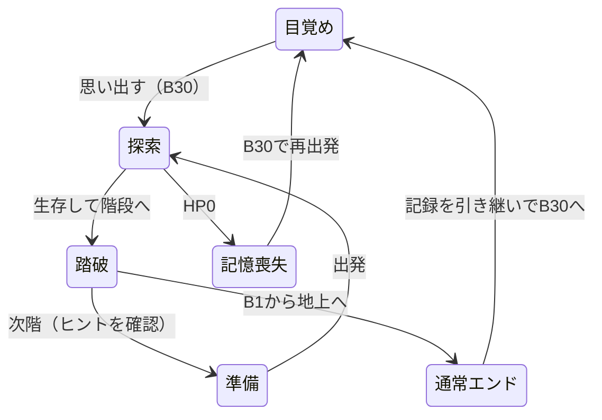

# 骸の旅路 ― システム設計書

> 現行は保存v16です。増援・一括取得削除は末尾のv16節を参照してください。旧版の取得条件・常時効果・カード数に関する履歴は、末尾の「オーグメント・カード取得 v15」と[詳細仕様](docs/cards/CARD_SYSTEM.md)で更新しています。

> **2026-11-01：骸のドット絵試作は削除・制作中止。** 本編使用中の `art/characters/mukuro-v1/` のみ保持。旧試作の画像・原稿・GIF・ZIP・専用生成器と試作専用テストは削除済み。以降の旧試作に関する記述は履歴であり、新規制作の参考に流用しない。最新の決定は [試作リセット](docs/characters/PROTOTYPE_RESET.md) を参照。

## 主人公素材の独立制作データ（2026-10-28）

最新添付由来の素材はscripts/build-reference64.pyでart/hero-reference64-v1/source/のJPEGから生成する。白背景除去、画像内の各動作の切り抜き、動作内共通倍率によるニアレストネイバー縮小、透過PNG・アトラス・JSON・ストリップ・GIF確認画像の書出しを行う。Pillowは制作時のみ必要。renderer.jsのloadReferenceHeroが使用可能なsequenceだけを描画し、未提供方向を暗黙に反転しない。preview.htmlで64px原寸と4倍表示を並べる。本編app.jsには接続しない。

64px比較案はscripts/build-hero64.jsで独立生成し、art/hero-64-v1/へ静止4方向のPNG・アトラス・JSONを出力する。32px生成器の出力を拡大せず、64pxの整数座標で骨格を描く。本編app.jsと32px用レンダラーの読込先は変更しない。

scripts/build-hero-sprites.jsが整数座標と16色パレットから透過32pxコマ64枚・アトラス・JSON・編集用配列を生成する。PNGエンコードはNode標準のzlibを使用し、再サンプリングや外部画像生成には依存しない。scripts/check-hero-sprites.jsで実PNGの復号後に個別コマとアトラスの一致・寸法・原点・透過外周・二値alpha・色数を検証する。

art/hero-game-v2/renderer.jsのloadHeroSpritesは画像とJSONを読み込み、寸法一致を確認。drawは足元座標・方向・動作・経過msまたはコマ番号から補間なしで描画する。状態・保存・乱数にアクセスしない。preview.htmlでこのレンダラーを使い、4方向4動作と24〜96pxの描画を検証する。本編app.jsからはまだimportしない。座標・読込例・制作条件は同フォルダREADME.md。

## タイトルと上部HUDの共通化（2026-10-27）

タイトルはエンジンphaseと分離した一時状態showingTitleで表示し、起動時はtrue。保存状態は読み込んで保持し、LoadGameでshowingTitleを解除する。タイトル中はループでtickせず、renderから自動保存しない。有効な保存の存在はhasSaveで管理し、NewGameは上書き確認後にnewGameへ進む。タイトルへ戻る場合は停止して既存状態を保存する。

opening.jsのopeningVariantがprofile.trueEndingから版を選び、app.jsがHTMLの画像data属性にある配信URLを参照する。初回は選択した背景とロゴのdecode完了も待ち、起動時の旧UI非表示を維持する。update-assets.jsは4画像にもバイナリの内容ハッシュを付ける。保存v11のprofile.trueEndingを真偽値で検証し、旧保存はfalseを補完。デバッグでのみ切替可能とし、ascendの通常エンド処理は変更しない。

上部HUDはbody:is(.preparing,.exploring) #hud-topの共通ルールで文字・バー・アイコン・レイアウトを定義する。ResizeObserverがHUDの実測高からworkspaceの--shared-hud-spaceを更新し、準備パネルがHUDに重ならないようにする。

## 初回描画の公開タイミング（2026-10-27）

index.htmlのhtmlにdata-startupを付け、外部CSSより前のインラインCSSで読み込み表示以外の要素を隠す。opacityとvisibilityでレイアウト寸法を残し、保存読込・renderScreens・Canvas描画・ResizeObserverの計算を隠れた状態で実行する。インラインのmoduleスクリプトがimport map経由でapp.jsを動的importし、成功後に2回のrequestAnimationFrameを待ってdata-startupと読み込み表示を解除する。外部スクリプト取得失敗もcatchし、再読み込みボタンを表示する。保存形式とapp.jsの状態復帰処理は変更しない。

## 図鑑・デバッグのスクロール領域（2026-10-27）

codex-dialogとdebug-dialogをscroll-dialogとして共通化する。閉じるボタンをdialog-toolbar、既存本文をdialog-scroll-contentで囲み、開いたdialogを縦方向flexにする。外枠のoverflowをhidden、本文のmin-heightを0・overflowをautoにして、高さ85dvh内で本文のみをスクロールする。44px角の閉じるボタンはスクロール領域の外側に置く。既存ID・data-close・イベント委譲は維持し、JSの閉じる処理や保存形式を変更しない。

## 物語文章と表記（2026-10-27）

story-text.jsが初回と通常エンド達成後の回想、開始時の思考、B15の思考を定義する。game-engine.jsは既存のプロフィールnormalClearsを参照し、同じ階クリア時に文章を保存する。app.jsは旧回想・ログ・保存済み次階ヒントを表示時に変換し、元のv11データは変更しない。階層名は既存zone IDを保ちdata.jsの表示名だけ変更する。旧50階共闘は現行の物語方針から外れたため、未使用の階数定数を削除する。

## 準備一画面とカード配置（2026-10-27）

prepare時はbody.preparingを付与し、探索のadventure／map Canvasと上部HUDを背景として継続表示する。map-vignetteで背景を暗くし、その上に固定の準備パネルとスクロール可能なタブ内容を置く。PC・横向きは16:9、幅600px以下かつ縦向きは画面高を使う。状態のexpeditionを既存status-dialogへ、共有journalを準備用dialogへ移動し、図鑑・歯車の単一DOMは探索と共通のHUDへ移す。探索へ戻る際は共有DOMを所定の位置へ戻す。

card-editor.jsはprepare時に対象／条件／行動／スキルのリストと既存の指示行を表示し、Pointer Eventsでドラッグ、ボタンのクリックで選択→配置を実現する。カードはtouch-action:pan-yで縦スクロールを許し、行ハンドルはドラッグを優先する。リストと行を別々にスクロールし、行内のカードは折り返す。探索時のlive-ordersは従来の無効化された閲覧UIを使う。

card-placement.jsは準備フェイズを確認し、ルールの複製上で置き換え・条件の移動／交換を試し、すべてvalidCardRuleを満たす時だけ一括反映する。行の並び替えも準備中のみ。パレットから対象変更する場合の実行カード初期化・不適合条件除去は従来のselect変更と同じ。失敗時は元データを保持する。保存対象は既存のordersだけで、選択元・ドラッグ状態・カテゴリは一時的なDOM状態。追加の保存移行やAI・戦闘ロジックの変更はない。

## 思考記号・ログ自動非表示とHUD拡大（2026-10-27）

app.jsはthoughtTextの表示時に「▶ 」を付ける。log-visibility.jsは探索オーバーレイへの移行またはログ内容の変更で5秒タイマーを設定し、変更がない再描画では延長しない。更新時の取消とgeneration検査で古いコールバックが新しいログを消さない。準備へ移る時はタイマーを取り消す。探索ログの非表示は親にis-expiredとjournal子にaria-hiddenを設定し、共有journalを準備側へ移した場合の常時表示・既存のスクロール追従を維持する。

screens.cssは探索HUDの文字・操作部を各画面幅で拡大し、ログ領域の幅と右揃え、MAP幅を指定する。ResizeObserverは画面幅480px以下で上下余白8px、その他20pxを計算し、MAPの空き領域上限の下限を64pxへ変更する。レターボックス状の背景は追加しない。タイマーや表示状態は保存せず、v11の形式・探索ロジックを変更しない。

## 正方形の視界（2026-10-27）

canSeeの距離条件をMath.hypotによる円形の格子判定から、max(abs(dx),abs(dy))による正方形判定へ変更する。radiusとlineOfSightは維持し、壁の遮蔽・斜め2壁の透過禁止を共通で適用。reveal、AIの視界条件、主画面・MAPの敵表示も同じcanSeeを参照する。敵の索敵・攻撃・経路距離のManhattan条件は別の仕様なので変更しない。

normalizeSaveは妥当性確認の後にrevealを呼び、既存保存にも読み込み直後から現在の正方形視界を適用。既知地形は消去せず追加発見だけ行い、遭遇図鑑も同期する。保存v11の構造は変更しない。cameraForの短辺基準の余白は正方形の四隅にも対応するため、カメラ数値は維持し角の投影を回帰検証する。

## キャラクター成長とダメージ通知（2026-10-26）

progression.jsにMAX_LEVEL・HP_PER_LEVEL・experienceToNext・gainExperienceを分離。game-engineの敵撃破確定箇所でdata.jsのexperienceを参照して1回付与し、statsの最大HPへレベル増分を加算する。level/experienceはスキルlevelsと独立。newGameで初期化、makeFloorでは保持。normalizeSaveはv2〜v11を受け付け、旧版にLv.1／経験値0を追加しv11の範囲・精算状態を検証する。

各攻撃・罠はdamageEventsへ座標・ダメージ・主人公かどうかを追記し、tick開始・階生成時にクリア。flash1個とは別に全被弾を通知する。app.jsが各tickのイベントを一度だけ描画キューへ渡し、damage-view.jsの寿命・浮上量・同座標の積み重ねを使ってCanvasへ描画する。RNGやAI判断を追加しない。描画キューはUIのみ、damageEventsは自動保存対象外、読込時も破棄。既存のセーブ書き出しに一時イベントが含まれていても読込時には再生しない。

レベルHUDはfloor-health内のHP直前に配置し、経験値割合とアクセシブルな数値説明をrenderで更新。準備のステータスと状態ダイアログは同じ状態を参照する。レベルアップは最大HPと同じ分だけ現在HPを増やし、HP欠損量を維持する。デバッグ経験値加算も共通処理を使用。旧節の保存v10記述は今回からv11移行仕様で更新する。

探索HUDの整列（2026-10-26）：index.htmlの図鑑・設定ボタンは同じviewBoxのインラインSVGを使い、CSSのinline-flexで中央を合わせる。screens.cssの探索専用規則と800px／480pxコンテナクエリで上部2段・下部の思考／操作分離を指定する。ログはCSS変数--log-lineの3倍をビューポート高さとし、本文の行高・余白を揃える。ResizeObserverによるHUD・ログ実寸からのMAP余白計算は既存方式を利用。DOMのボタンID・操作ハンドラ・保存v10に変更はない。

更新：2026-10-26。詳細数値と機能の正本は[SPEC.md](SPEC.md)、世界観・企画は[DESIGN.md](DESIGN.md)。

## 構成

| ファイル | 責務 |
| --- | --- |
| data.js | テーマ・敵・装備・購入能力5項目・報酬6種・敵ID別ドロップテーブル |
| field-events.js | 通常30階／手紙B15、区間対応、異変の決定と次階のヒント |
| orders.js | 基本20＋取得制特殊2指示の条件・優先順位・枠数・移動先判断 |
| map-view.js | 発見済み地形・公開マーカー、グリッド描画、視界に合わせる追従カメラ |
| drop-system.js | 二段階ドロップ、重み付き抽選、保存内乱数、報酬付与 |
| game-engine.js | 探索・戦闘・装備・育成・ステージ生成・イベント発動・セーブ移行 |
| thought-view.js | intentの自然な独り言字幕への変換 |
| engine.js | エンジン機能の公開入口 |
| skill-tree.js | 購入能力5項目の2分類一覧。グラフ・ノード座標は持たない |
| debug-tools.js | 階移動・能力変更・装備生成 |
| app.js | 画面の描画、操作、停止、音、自動保存、記憶の取得一覧 |
| index.html / screens.css | 準備・探索・終了ヒント・図鑑・デバッグの表示 |

## 状態遷移

TRUEエンドの状態遷移は未実装。旧50階共闘構想は現行ルートに含めない。

## フロア生成とヒントの一致

1. シードと内部階番号から `fieldPlan` で異変を一度決定する。地形用の乱数系列とは独立。
2. 5階ごとの区間を選び、部屋と通路を生成する。
3. 開始点・階段、通常敵・泉・宝箱、B15の手紙を配置する。B20・B10の場合は早期に固定闘技場生成へ分岐し、乱数による配置を行わない。
4. ハウスの場合は開始部屋・階段部屋以外から1室を選ぶ。残りの空き床へ追加敵または罠を置く。霧は地形を変更しない。
5. 踏破時は次階の `fieldPlan` と同じ入力でヒントを作り、`nextHint` に保存する。次階生成時も同じ結果を使う。

プレイヤーが読める危険のヒントと、AIが知る敵・アイテムの座標は分ける。ヒントを理由に未発見位置をAIへ渡さない。

## 異変の状態

- `gimmick`：種類ID、表示名、入室済みフラグ、対象部屋の矩形。
- `enemies[].house`：追加敵の印。対象部屋へ入るまで行動しない。入室時に全追加敵を追跡状態にする。
- `traps[]`：位置、作動済み、発見済み。トラップハウスは全位置を表示モデルへ渡し、通常罠は地形発見後に表示する。作動前後を色分けする。
- 霧は `radius` で視界を減らす。地形発見・敵の視認・AIの対象判断・描画で同じ視界判定を使う。
- 作動フラグ、罠、敵、ヒントを通常の保存へ含め、再読み込みで再配置しない。

## ターン処理

再生の祈り → 退避優先判定／隣接攻撃／指示による移動 → アイテム取得・泉 → ハウス入室 → 罠と死亡判定 → 生存敵の行動と死亡判定 → 視界更新 → 階段踏破・報酬・次階ヒント。

踏破は実際の階段座標と一致した場合だけ。死亡後に報酬や次階移動を行わない。

## セーブv10と移行

- 保存キーは維持。`floor` は通常30階の内部番号。`profile` は通常エンド達成・図鑑・周回記録。
- 旧50階の番号は進行割合で30階へ写像し、生成済みの現在階を維持する。新しい異変は次階から導入する。
- 廃止した指示スキルを削除し、その取得段階の旧費用相当を補償。装備・能力・指示列・指揮段階を維持する。
- 手紙箱は新しいB15に整合させる。取得済みの手紙は消さない。
- 変換前は別キーにバックアップし、純粋なコピーを変換する。詳細式と補償の扱いはSPEC第12節。

## 検証方針

全30階の連結性と重複配置、基本指示の初期利用・特殊指示の取得制約・枠数制約、B15条件、次階予告と実生成の一致、追加敵の待機・一斉活動、罠の一回性・死亡順、霧の視界共通性、JSON復帰と旧版移行を検証する。通常エンドまで複数シードで通し実行し、停止不能・報酬重複・進行不能がないことを確認する。

## 追加設計（2026-10-25）

- 初期phaseはawakening。開始画面で既存primaryボタンを「思い出す」にして唯一の操作とし、prepare／exploreへ同じボタンを移し替える。通常の準備はB29以降。
- B20とB10はdata.jsのminibossesを共通マスタに追加する。makeBossFloorが固定地形・固定座標を生成。bossフラグを持つ生存敵がいれば階段判定を止める。
- fieldPlanは中ボス階を先に判定し、予告と実配置の一致を保つ。通常罠は異変なしの階で独立乱数から抽選する。
- autoMapModelはseenを元に地形を返す。敵は現在の可視判定、トラップハウスは全罠公開という例外を明示する。主画面とオートマップで同じ罠条件を使う。
- thought-view.jsのthoughtTextがintentを独り言へ変換。app.jsは下部帯のthought-subtitleを現在の字幕1件で更新し、role=statusで通知する。旧Chat履歴・吹き出しの座標計算とDOMは廃止。
- v6→v7は罠表示を更新し、開始前のB30だけawakeningへ移す。現在階の地形は再生成せず、固定中ボス階は次回生成から適用する。

## 本編機能の整理（2026-10-25）

- data.jsからidentify／uncurse／synthesis／bondを削除。app.jsは2分類の購入能力一覧から直接upgradeを呼ぶ。mendは前提なしのドロップ報酬へ移し、ツールチップ・ノード描画・素材ダイアログは除去する。
- 装備の生成・取得・デバッグは鑑定済み・非呪いに統一。旧identify／uncurse／synthesizeは互換入口としてfalseを返すだけで、旧スキル段階を注入しても本編操作は成立しない。合成計算は将来案の純粋関数だけ保持。
- normalizeSaveはv7以前をコピーしてv8へ変換。旧4スキルの習得費用を一度返還し、所持・装備中・未開封宝箱を清浄化。入手済み図鑑も公開する。地形・乱数シード・進行は保持。通常ドロップでは旧呪い／未鑑定抽選に相当する乱数を消費してから非呪い・鑑定済みに固定し、他の配置への影響を避ける。
- 手紙のobtainableは通常エンド達成＋未取得のみとし、bondへの依存を廃止（代替条件は仮採用）。TRUE END後の機能解放状態は本編の未実装中には追加しない。

## 追従カメラと探索HUD（2026-10-25）

- cameraForは主人公の補間座標と有効radiusから縦2×ceil(radius)+3マスの投影を返す。app.jsはCanvasをsave→scale→translateで世界座標へ変換し、地形・品物・敵・主人公・攻撃フラッシュを同じカメラで描く。restore後に画面全体の霧を描く。
- miniMapGeometryはセル4／6pxと外周1pxを含む幅・高さ・境界配列を返し、drawMiniMapは地形→グリッド→セル内マーカーの順に描く。表示モデルは従来の発見・可視情報境界を維持。CSS縮小は行わない。
- ステータス帯をマップ直上へ移動し、hud-floor／hud-shardsと既存HP・ATK・DEFをrenderで同期する。字幕はマップ下部の帯で通常の文書フローに置く。ResizeObserverは停止中もカメラとミニマップサイズを再描画する。この配置変更自体ではゲームロジックは変更しない。保存は現行v9。

## Clear表示とヒントの統合（2026-10-26）

- app.jsはphase=clearedの表示をClearとし、既存nextHintまたはnextStageHintの結果をmap-notice内のclear-hintへ描画する。独立next-hint要素と描画・CSSを除去。死亡／通常エンドも同じ終了メッセージ内に補足する。
- 保存内のヒントは変換せず、title先頭の「次は」を表示時のみ除去し、文字列はHTMLエスケープする。この文言変更自体ではゲーム判定・報酬を変えない。過去ログは維持し、新規成功ログのみClear表記。
- index.htmlから冒頭のsubtitle要素を削除し、CSSで見出し・イントロ・主領域の余白を詰める。

## 感覚・ヘッダー・オプション（2026-10-26）

- data.jsのscoutはcost=10、costStep=8、max=4。priceはcostStep未指定時に従来の4を使う。radiusは3+scout-霧2（下限2）。既存v8の段階・残高は変換せず新効果を適用し、追加請求しない。
- HUDのhud-sightと右カードの視界専用行へ同じradiusを表示。旧ログの通貨名は描画時のみ統一。保存内の文言は変更しない。
- introとscreen-headingを削除し、app.jsも削除要素への参照を除去。brand-groupに英語名と横並びサブタイトル、header-rightにoptions-openを配置。目覚めではgame-iconsだけを隠し、オプションを残す。
- options-dialog内にdebug-openを移動。既存openDialog／finishDialogを再利用し、ネスト中は探索停止と元の停止状態を保つ。すべてのダイアログが閉じた時だけ元へ戻る。

## 上下帯と進行ボタンの整理（2026-10-26）

- dungeon-viewport内にstage-band-top／map-wrap／stage-band-bottomを配置し、上下帯は--stage-band-heightを共用。HUDの末尾へ速度ボタンを移し、記憶の欠片の右に配置する。canvasカメラ座標・地形生成は変更しない。
- 単一のprimaryをフェイズに応じてawakening-start／launch-area／notice-actionsへ移動する。notice-copy（終了文）とnotice-hintだけinnerHTMLを更新し、ボタンを含むnotice-actionsのDOMを再生成しない。これによりハンドラと単一ボタンを維持する。
- pause-toggleは探索中のみ表示する別ボタン。同じクリック処理でpausedを反転し、ひとやすみ／探索を再開を切り替える。主マップ中央の休憩表示を復活し、phase=exploreかつpausedかつダイアログなしのとき既存map-noticeへ描画する。終了フェイズのnoticeを優先する。旧restart・prepare-restart・playback・map-bottom・thought-chatは除去する。
- CSSの仮グレーテーマはUIに適用し、区間のCanvas配色は維持。現行の保存形式はドロップ導入でv9。

## 最強装備・あきらめる・レターボックス（2026-10-26）

- equipBest(s)はprepare以外を拒否。各slotのgearStatsを比較し、identifiedかつ非呪いの所持品をacquiredOrderで安定化して選択する。現在のスコアを超える場合だけ既存equipを呼び、装備・在庫の個体IDと入手順を保つ。2スロットを処理してもポイントやターンは変えない。
- あきらめるはprepareのUIハンドラからabandon-dialogを開き、確定後、abandonRun(s)→newGame(profile)を使い、表示更新は既存reset(next)を再利用。キャンセルではresetしない。新しい保存形式は追加しない。説明とabandon-runをpreparation-launchへ置き、primaryは従来どおりlaunch-areaの先頭へ移動する。
- dungeon-viewportへletterboxed-viewを追加。上部letterbox内にdungeon-hudを移動し、speedをHUD末尾へ置く。下部は字幕と休止ボタンを保持。区間／TURNはmap-wrap内の下端へ移動。中央のCanvasの寸法・カメラの式は変更しない。

狭い2カラム画面にも対応するため、adventureをinline-sizeコンテナにし、ゲーム枠600px以下では上部を2行・上下96pxへ切り替える。通常は上下56px。letterboxのborderは0とし、主マップとの境界線を描かない。HUDの上下paddingを6px、2行時の行間を4pxに詰めて情報を収める。

探索時はjournalをadventureの末尾に置き、ゲームフレーム内で下部レターボックスの直後に表示する。journalの外枠・角丸・余白を除去し、上端の区切りだけを置く。expeditionは右列の1行目。renderで同じjournal要素を探索時はadventureへ、準備・目覚め時はworkspaceへ移す。ログや自動保存表示のIDとイベントは保持し、準備時の表示・保存処理も維持する。

ログの本文領域#logsは240px、上下padding各8px、log-rowはmin-height32pxで約7行分を確保する。長文は自然に折り返す。初期半径3・最大7を共有radiusで計算し、視認・AI・HUD・カメラへ共通適用する。既存v8は段階と探索済み地形を維持し、半径を再計算する。

## ドロップ・取得スキルの設計（2026-10-26）

- data.jsのenemyDropTablesは敵IDごとのrate／entries。各entryはtype／id／weightを持つ。通常22%・重装30%・中ボス100%は仮採用。rank距離重みを装備20品のentriesへ展開する。rollEnemyDropは第1段階失敗なら第2段階を呼ばず、成功時にweightedPickで1品を返す。特殊報酬はrewardDefinitions、箱の重みはchestRewardsに分離する。
- drop-system.jsのnextRandom(s)がs.rngStateを32bitで進め、戦闘と拾得の抽選を保存から再開する。フロアのレイアウト・箱報酬は既存seed＋floorの独立した生成乱数を使う。箱は生成時のrewardIdを保持し、AIのobtainableは手紙の物語条件を参照し、通常箱は鍵不要。
- attackEnemyで通常打撃→生存なら追撃抽選→追加打撃→死亡処理。各打撃に会心と実ダメージ吸収を適用。死亡処理は登録済みかつ生存中の敵だけ実行し、撃破報酬・ドロップは1回。品の床が埋まっていればBFSで近い空き床へ置く。
- pickupはtypeで装備・戦闘報酬・薬草・欠片・箱・手紙・泉を処理。箱は鍵不要でgrantRewardを呼ぶ。同名所持は+5ptへ変換し効果を重複させない。abilities／unlockedOrdersは周回リセット、profile.skillsは継続。
- tacticsはactiveOrdersの存在で隣接攻撃優先を切替。warpはchooseOrderから緊急アクションとして返し、エンジンで全合法床から抽選する。warpedは階生成時にfalseへ戻す。罠見切りは指示の経路blockedと最終罠処理の両方へ適用する。敵が回収対象を塞いで指示不成立となる時は基本接近し、2地点の往復を防ぐ。
- v8→v9は旧tactics／mendを削除・8／10pt返還し、mendの能力と図鑑登録を引き継ぐ。tacticsは空き枠だけ自動設定。生成済み旧gear箱を鍵不要で保持。地形を再生成せず、次階から新規箱を配置。v2〜v7の従来の移行段階を通した後にv9へ上げる。
- スキル図鑑は既存codex-dialogを共用する独立のskills表示分岐。名前・効果・種類・当該旅の所持状態を表示し、未取得は？。右ステータスに取得報酬一覧を表示する。鍵表示は廃止。指示エディターの再描画signatureにはunlockedOrdersを含め、取得直後に選択肢を更新する。

仮バランスの再検証はscripts/balance-audit.jsで固定10シード・瀕死時の回復＋宝箱回収・最強装備・守護／剣技／生命の購入方針を通し実行する。特定方針の比較であり、実プレイヤー全体の勝率としては扱わない。

最終仮採用では通常敵・重装敵の基礎攻撃+1、中ボス据置、BALANCE.springHeal=10／restRatio=.15。通常階のコモン2品は薬草25%・欠片75%。回復品の指示は泉と薬草を対象にする。

ひとやすみ表示はapp.jsのrenderで既存noticesのフォールバックとして選ぶ。再開時に非表示にし、nextHintやprimaryを探索中に出さない。新しい保存フィールドや停止処理は追加しない。

## 公開確認の工程

.github/workflows/test.ymlのGame testsでpush・PR・手動実行ごとにNode.js 24のnode --testを実行する。依存パッケージのインストールは不要。Pagesのデプロイとは独立したテストであり、公開完了は両方の成功と公開URLの実操作確認をもって判断する。公開ゲームの検証結果を実装メモへ残す。

## 探索指示の編集制限（2026-10-26）

orders.jsのaddOrder／editOrderとgame-engine.jsの旧setModeはphase=prepare以外を拒否する。app.jsのrenderOrderEditorも同じ条件で全編集部品を無効化し、探索側の説明は閲覧のみとする。pausedは編集権限に影響しない。取得した特殊指示のunlockedOrdersへの登録は維持し、設定は次の準備で行う。既存保存は変更せずv9を維持する。

公開検証でHTML更新後もESモジュールの古いキャッシュが使われる事象を確認したため、scripts/update-assets.jsで全ブラウザ用JSとCSSの改行正規化済み内容SHA-256の先頭12桁を?v=として生成する。index.htmlのimport mapを最初のモジュールより前に配置し、appのsrc・CSSのhrefも更新する。Windows／Linuxの改行差はハッシュに影響させない。CIは--checkで生成忘れを検出する。Nodeのimportと保存は変更しない。

## カード指示の構成と実行（2026-10-26）

card-orders.jsでカード定義、妥当性検証、条件AND、対象選択、説明文、旧指示変換を共有。card-editor.jsで編集UIを生成し、追加・変更APIもphase=prepareを検証する。orders.jsは旧指示の互換関数を保持するが、新規画面はカードのみ。

chooseCardOrderが上から実行可能な主行動を返す。cardModifierで戦術・罠回避を別途評価。通常の移動より隣接戦闘を優先し、回復・転移・退避だけ先行する。敵攻撃カードは選んだ対象へ接近・攻撃する。mendは移動せず主行動を1ターン消費し、次に拾得・罠・敵・階段の既存順を通す。

保存v10はordersにtarget/conditions/effect、levelsにcardSlotsを持つ。v9→v10はlegacyToCardsを各行に適用し、再生所持かつ空き行がある場合だけHP35%以下の回復行を先頭に補う。満杯なら設定は次の準備に委ねる。既存の地形・進行・RNGは保持。条件値・上限・所持報酬を検証し、同じ移行の再実行はしない。キャッシュURLはupdate-assets.jsで再生成する。

## 透過HUDとログダイアログ（2026-10-26）

index.htmlのmap-wrap内へhud-top/hud-bottom、log-openを配置する。区間種別のzone要素と旧帯を削除。renderScreensはutility-controlsの単一DOMをheader-tools/hud-toolsへ移し、同じIDとイベントを維持する。journalは準備中workspace、探索系フェイズではlog-dialog-contentへ移す。ログ本文とsave-statusも単一DOMを共用する。

log-dialogは既存openDialog/finishDialogとcloseイベントを共用し、dialogWasPausedで元の停止状態を保持する。volumeはページ内変数（0〜100、初期35）でWeb Audioのゲインを調整し、0なら発音処理を行わない。ゲームの保存JSONには追加しない。

ResizeObserverでHUD高さをCSS変数へ伝え、MAP・ログボタン・メッセージの位置を補正する。幅650px以下ではCanvas表示高さ380px。drawは表示比率から内部高さを計算し、cameraForは幅と高さの小さい方からスケールを決めて視界とピクセル比率を維持する。ゲーム状態や探索ターンは変更しない。保存v10を継続。

## 一画面探索とチャットログ（2026-10-26）

renderScreensでprepare/awakening以外のフェイズにbody.exploringを適用する。CSSでヘッダー・フッターを隠し、workspaceをviewportに内接する最大16:9へ配置する。map-wrapの幅・高さをworkspaceへ一致させ、旧380px指定を上書きする。

journalの単一DOMは探索系フェイズでfield-log-host、準備でworkspaceへ移す。renderJourneyLogは探索では全記録を逆順（古→新）にし、描画前の末尾距離が8px未満、または表示モード変更時だけ末尾へ追従する。ログが同じ場合はDOM更新せず、履歴閲覧中はscrollTopを維持する。表示は非モーダルで探索停止を発生させない。

expeditionは探索時status-dialog-contentへ移し、status-openから既存のモーダル停止制御で閲覧する。準備ではworkspaceへ戻す。phase-label/memory-countはoptions-dialogへ、memory-quoteはthought-stackへ移し、従来のrender同期を維持する。field-gimmick/floor-messageはマップ内のhud-alertsへ移動。ゲーム保存v10と進行ロジックは変更しない。

進行検証でfrontierが訪問済みの床（現在地を含む）を目的地に選んで停止する既存不具合を検出。card-orders.js/旧orders.js/基本行動のfrontier探索にvisited=falseを追加し、経路の中継点は訪問済み床も許可する。最大視界で複数マップの階段到達を回帰テストする。保存の再生成は不要。

同じ検証セーブで、移動敵によりblockedが毎ターン変わりfrontierの経路が2マス間で反転するケースも再現。探索系カードと互換指示では距離条件内の視認敵へ基本接近する経路を先に評価して解消する。固定シード181975の最終階と書き出した検証セーブの再生で階段到達を確認。状態履歴や新しい保存項目は追加しない。

## 入室式MAPと端末表示モード（2026-10-26）

map-discovery.jsが保存済みgridから2×2床に属するセルを収集し、31×23の通常マップではxの10マス区分・y=12の生成区画で分割して隣接部屋を分離する。bossFloorでは区画を分けない。各領域に現在位置またはvisitedがあれば床と周囲の壁を描画モデルへ追加し、通路のseenと合成する。seen/visited/gridは変更しない。既存JSONのvisitedがそのまま入室履歴になる。

map-view.jsのマーカーはMAP公開位置と従来の発見・視認条件の積でフィルタする（トラップハウス罠は公開例外）。CanvasをclearRectして、公開セルだけ外周グリッド＋内側地形を描画。未公開セルは透明。MAP見出しはDOMから削除。探索ログの見出し・枠・時刻列はfield-log-host配下のCSSだけで非表示とし、準備のjournalを維持する。

display-mode.jsはユーザー操作からrequestFullscreenを先に要求し、成功後にscreen.orientation.lockを試す。両APIの拒否は捕捉し、部分的な対応も結果として返す。app.jsがタッチ端末の開始／再開時にページ内1回だけ呼び、手動ボタン・表示案内・fullscreenchangeでの解除を担当。独立関数は未対応／拒否／向き固定不可をモックで検証する。保存v10を変更しない。

### タイトルの再開確認
共通ロゴ枠はaspect-ratio:2.5、画像はobject-fit:contain。LoadGameではload-game-dialogを開き、confirm-load-gameでshowingTitleを解除する。既存dialog-closeとabandon-confirm-actionsを共用し、キャンセルでは旅の状態を変更しない。

## Full HD描画
主Canvas #mapは1920×1080固定。drawで表示領域比から内部高さを再設定しない。cameraForには同Canvas寸法を渡すため、視界半径と表示マス数を保った描画倍率を得る。CSSによる端末サイズへの縮小を継続。タイトル背景は1920×1080PNG、原本は別名で保持。

## タイトル動画の層とライフサイクル
#title-fxは背景・ロゴより上、メニューより下の装飾video（z-index:2、ロゴ:1、メニュー:3）。title-contentにはスタッキングコンテキストを作らない。pointer-events:noneで背後の操作を妨げない。syncTitleEffectをrenderTitle・visibilitychange・タイトルpointerdownから呼び、showingTitleかつdocument非表示でない場合だけplayする。play拒否は捕捉してタイトル操作を継続し、非表示時はpauseする。配信動画もupdate-assets.jsのバイナリハッシュ対象とする。

透過互換：WebMの最初のフレーム左上（元素材では透明）のアルファ値で透過デコードを確認する。不透明または再生非対応／取得失敗時はH.264 MP4の黒背景版＋CSS screen合成へ切り替える。代替合成は元のアルファ合成と完全一致しない。代替版も失敗した場合は背景・ロゴ・メニューだけで操作を継続する。両配信動画は1920×1080・30fps・14秒、音声なし。

タイトルシーンをinline-sizeコンテナにし、ロゴ枠とメニューを共通シーンに対する絶対配置へ変更。title-contentのflex中央揃えによるロゴ位置計算とviewportベースのタイトルメディアクエリを廃止。cqwはシーン幅を参照する。動画と背景の100%表示に対しロゴも一定の正規化座標で追従する。

動画制作下地の生成はscripts/export-title-backgrounds.js。screens.cssのtitle-logo-frame配置（left/top/width/aspect-ratio）を読み取り、元画像を再生成せず合成する。Sharpは制作時だけ必要、ゲーム実行時の依存は追加しない。暗幕とロゴ影は現在のタイトル装飾に合わせる。

## v3動画切替
syncTitleEffectでopeningVariantからvideoのdata-mukuro/data-segareを選ぶ。版が変わった時だけsrc/loadを更新し、fallbackActiveとscreen合成を解除、対応するMP4代替URLを選び直す。loadeddataで毎回透過を確認する（readyState<2は除外）。loop/muted/playsinlineは同一video上で両版とも維持。

## 開始前映像の遷移
pendingJourneyに開始／再開コールバックを保持し、playJourneyTeaserで全画面セクションを表示する。showingTitleは終了までtrueとしてtick／自動保存を防ぐ。ended・skip・Escape・メディアerrorはfinishJourneyTeaserに集約し、pendingJourneyを先にnullにして二重実行を防止。タイトルのエフェクト再生条件にも!pendingJourneyを追加。映像終了時に初めて新規resetまたは保存フェイズのrenderを行う。

playJourneyTeaserの入口でopeningVariantがmukuro以外なら映像UIを表示せずコールバックを即実行する。タイトルの版は新規初期化前の達成記録で判定。

開始前映像の配信ファイルjourney-teaser.mp4はNewGame_12s_1080p.mp4の再格納版（1920×1080・24fps・12秒・音声なし）に更新。遷移と骸限定判定は変更しない。

teaser-sceneは黒いviewportオーバーレイ、teaser-frameはタイトルと同じ16:9寸法の中央枠。videoとteaser-actionsを同じ枠の子要素とする。videoをabsolute inset:0、min-width/min-height:0で配置し、メディアの固有サイズとgridの最小サイズに依存させない。

## 地下墓所テクスチャの読込・描画
terrain-view.jsのdrawCryptTileが、32pxの2×2アトラスから床／壁と座標ハッシュによる2種類の差分を描く。Image.completeと64×64px寸法を確認し、失敗時はfalseで既存レンダラーへフォールバックする。隣接床に接する壁だけ境界を補う。描画先の既存24px論理座標・カメラを維持し、画像補間を無効化する。マップデータ・乱数・保存には書き込まない。
index.htmlのmap[data-terrain]にハッシュ付きPNGを設定し、app.jsがdecode完了後に再描画する。update-assets.jsがPNGとモジュールの内容ハッシュを更新する。scripts/build-crypt-tiles.jsは64px原本から32pxアトラスを再生成する制作時ツールで、Sharpはゲームの実行時依存にしない。

## 小物アトラスと墓石
prop-view.jsは6種類の32pxセルを描画し、画像未読込・寸法不正・未対応種別はfalseを返して従来スプライトへ戻す。装備欄のCSSアイコンも同じハッシュ付きPNGを参照する。小物の配信URLはmap[data-props]をupdate-assets.jsで更新。
crypt-obstacles.jsのplaceCryptObstaclesは新規地下墓所の敵・アイテム・罠を置いた後で候補を選び、BFSで歩行床の接続を検査してgridを0へ変更しobstaclesへ記録する。各部屋1基、全6部屋まで。validateSaveは任意配列を検証し、normalizeSaveは未設定のみ[]で補完する。
roomMapTilesは墓石マスを部屋形状の判定時だけ床として扱い、表示上のwalkableはfalseを維持する。描画時は墓石マスだけ床テクスチャを下敷きにし、小物レイヤーで墓石を重ねる。衝突・視線・ドロップ地点は実gridを参照する。

## 描画の奥行き（2026-10-28）

app.jsは平面地形・階段・罠を先に描き、scene-depth.jsの足元ソートで立体壁と各エンティティを描く。wall-tileset.jsが専用の壁上面・境界正面・連続側面の画像選択を担当（後述のwall-parts/v1参照）。描画用surfaceは墓石の下を床として復元し、0/1で保持するがstate.gridを書き換えない。standingBoxは足元を保持して高さだけ伸ばす。主人公に重なる手前壁の透明度を計算し、ダメージ数字は高くなった頭上へ移す。

scripts/lib/tile-edges.jsで同系統の配信用端画素を揃える。scene-depth.test.js・wall-tileset.test.jsとtest-support/png.jsで64px／32px原本・配信PNGの全バリアントの辺一致、透過余白、描画順、足元、壁面接続を検証する。画像生成原案はGit対象外、通常プレイ時に制作依存ライブラリは不要。

## wall-parts/v1（2026-10-28・現行）

wall-tileset.jsがJSON検証・画像実寸確認・theme登録・接続パーツ選択・drawImageを担当。app.jsのdata-wallsに空白区切りで定義URLを登録し、テーマ用または*既定セットを選ぶ。terrain-view.jsは専用素材描画と読み込み失敗時の単色表示のみを担当し、旧アトラスを壁面に渡さない。

原本→配信生成はscripts/build-wall-tileset.js。画像ハッシュをtileset.jsonに書き、update-assets.jsが画像ハッシュを検証したうえでindexの定義URLを更新する。形式説明・JSONスキーマ・複製用テンプレートはart/terrain/walls/に配置。wall-tileset.test.jsが版・欠落・範囲・接続端・描画元・URL解決・エリア上書き・透過・継ぎ目・容量を検証する。

## 視界と立体素材の明暗（2026-10-28）

scene-lighting.jsが暗色アトラス生成／キャッシュ、床の公開区分、描画用視界座標、透明行を除く接地補正を担当。専用アトラス全体にsource-atopで暗色を一度重ね、wall-tileset.jsはImageまたはCanvasを同じ矩形で描く。透過輪郭は保持。壁の明暗は床パスでなく壁パスへ適用し、視界外壁を薄い透明画像にしない。

描画用の視界stateは補間中の最寄り整数マスを持つ浅いコピーとし、元のstateは変更しない。画面外の壁はカリング。未発見床の非表示とMAP・AIのcanSeeを維持。scene-lighting.test.jsで暗色処理の合成方法とキャッシュ、未発見床、遮蔽・視界半径・非変更、透明行の異なるユニットと影の接地一致を検証。

## 拡張グリッドと保存v12（2026-10-28・現行）

game-engine.jsの新規グリッドは47×35、通常階のroomsは9矩形。1マス通路の接続に追加経路を設ける。移行では現在階を再生成せずversionを12へ進める。validMapShapeは新旧の寸法と配列形状、任意roomsの範囲を検証する。reveal・warpDestination・app描画・miniMapGeometryは保存中のgrid実寸を使用。map-discovery.jsはroomsがある場合に明示的な部屋単位で入室を判定し、旧セーブには従来の推定方式を残す。

sceneDrawOrderは壁・小物を足元順に描いた後、視界内のキャラクターを足元順に描く。透過による遮蔽回避は削除。floorLightは視界内／薄暗い視界外の2区分になり、地形の表示とゲームの発見情報を分離する。cameraForの余裕を7行へ変更。壁の専用定義rise=.75と32×56セルにレンダラーが追従する。

壁の32pxアトラスを直接編集し、build-wall-tileset.jsはPNGヘッダ実寸とtileSize32の検証、画像ハッシュ更新のみを行う（Sharp不要）。64px原本は互換資料として保管。expanded-map.test.jsで拡張寸法・独立部屋・狭い通路・階段経路・旧寸法保存と次階拡張を確認し、既存の接続／全30階走破／移行／MAP／描画のテストも更新する。

## 前景壁の描画矩形（2026-10-28）

wall-tileset.jsのwallDrawBoxが真上の床に接する壁を前景壁として識別する。前景は自分のセル内、その他はrise分持ち上がった通常矩形を返す。drawWallPartsの全パーツとterrain-view.jsのフォールバックが共通の矩形を使う。シミュレーション・素材・描画順を変更しない。wall-tileset.test.jsで横通路・部屋下端・分岐の24px／32px表示、地形の非変更、奥側の高さ維持、フォールバックを検証する。

## 準備UIと予測システム（2026-10-28）

exploration-forecast.jsは本編tickを使う複製シミュレーション、集計、指示構成の注意判定を担当。24ターンごとにイベントループへ制御を戻し、試行間もyieldする。app.jsは指示・育成・装備・HP・所持品等のシグネチャとチケットで同一結果をキャッシュし、編集・タブ遷移・出発時に古い計算をキャンセル。予測に永続化やworker用の別ロジックを持たせず、本番の乱数を消費しない。

ui-settings.jsはミニマップの選択値を別キーへ保存し、htmlのdata-minimap-sizeとCSS変数で描画幅を切り替える。storage拒否・破損は中へ戻す。ネイティブCanvasのセルは6pxとし、CSS拡大で3サイズを表示。準備パネルをinline-sizeコンテナとし、PC・スマホとも共通論理幅で3列を適用する。

card-editor.jsは表示順とフレーム識別を分離し、カード配置APIは維持。状態タブへ既存サマリーを複製する際はid属性を除いて重複を防ぐ。entrance-view.jsは描画用surfaceから入口の壁セルを判定し、grid参照が変わった時だけキャッシュを作り直す。入口素材のURLはindexのdata-entrancesから取得し、update-assets.jsで内容ハッシュを更新する。preparation-ui.test.jsで設定保持／破損・予測集計／キャンセル／非変更・入口判定／床非配置・PNG寸法／透過／容量を検証。

## entrance-parts/v1（2026-10-28）

entrance-view.jsのvalidateEntranceTileset／loadEntranceTilesetsが版・32px矩形・実寸を検証してtheme別Mapを返す。入口検出の内部番号は部品名へ変換し、drawEntranceは定義内の矩形とバリアントを選択する。固定64×64画像・固定セル番号による切り出しを廃止。暗色アトラスも同じ定義を保持する。

build-entrance-tileset.jsは任意フォルダのPNG検証と画像ハッシュ更新のみ。update-assets.jsは壁・入口の登録JSONと画像ハッシュを検証する。entrance-format.test.jsで拒否条件・異なるアトラス配置・バリアント・テーマ上書き・相対URL解決・読込失敗を検証する。

## wall-autotile/v1（2026-10-28）

wallNeighborMaskが描画用surfaceの4隣接からビットを生成し、drawWallPartsが定義のtiles[mask]を1回描画する。validateWallTilesetは新形式と旧wall-parts形式を分岐検証する。16番号・順序・寸法・範囲を検証し、旧定義の互換テストはparts-tileset-v1.jsonを使う。

build-wall-autotiles.jsが新規岩壁アートの32px原稿から16チップを構成する。build-wall-tileset.jsはJSONに指定したPNGを検証し、固定のatlas-32.pngファイル名へ依存しない。wall-autotile.test.jsは全16番号・斜め非依存・画像選択・定義拒否条件・接続辺の最終PNG画素一致を検証する。

## 共通仮想画面と端末方向（2026-10-28）
display-mode.jsのsceneLayoutが1280×720の論理寸法・等比倍率・タッチ縦向き判定を返す。app.jsはresize／visualViewport.resize／fullscreenchangeでCSS変数--game-scene-scaleを更新する。screens.cssはmainとworkspaceを固定論理寸法にし、中央基準のtransformで表示する。コンテナ幅はPCとスマホで共通となり、HUDと準備3列を同じ規則で描画する。
縦向き案内はnative dialogで背景操作を止め、探索をpausedにする。横向きへ戻った際も自動で探索を再開しない。全画面要求はユーザー操作から実行し、準備遷移時の自動exitFullscreenを廃止。保存モデル・描画Canvas寸法・素材形式は変更しない。

## 岩壁アートの構成（2026-10-29）
ビルド入力を生成アートの32px原稿painted-32.pngへ変更。岩面と正面の画像を使い、4方向接続番号に従って16チップを出力。15番は岩面を全域に充填。生成余白除去・4pxの折り返しなじませ・接続辺の同値類による画素統一を制作時に実行し、実行時の負荷は変更なし。旧パーツ原稿は互換保管。PNG→JSON→indexの内容ハッシュを更新する。

## wall-material/v1 → wall-autotile/v2（2026-10-29）
制作入力material.jsonの原稿・色調倍率・zoneを検証し、壁上面／正面の共通32px原稿から16接続＋4入口を構成する。PNGパレットと光源・投影を共有し、入口の色調が壁から乖離しないようにする。実行時はloadWallTilesetsだけで画像を読み込み、drawWallPartsが接続チップに同じアトラスの入口を重ねる。drawRaisedWallへ入口番号を渡し、前景壁も同じwallDrawBoxで描く。
app.jsからloadEntranceTilesets・drawEntrance・data-entrances依存を除外。entranceWallFramesの肩検出だけを継続する。暗色化キャッシュも同じ画像へ適用。v1壁互換は継続し、v2ではmaterialと4入口の32×56矩形・共通投影を必須検証。制作入力と配信用のテンプレート・スキーマを分離する。

## CharacterAnimation / character-4dir/v1（2026-10-29）
character-animation.jsに個体別の位置・方向・状態・サンプル時刻、方向判定、切り抜き矩形、足元バインド、Canvas描画、JSON/PNGローダーを分離。実時計をクラス内部で読まず、探索が動いている間だけ進むheroClockをapp.jsから渡す。moveToとattackToは描画状態のみ更新し、エンジンの行動を遅延しない。
主人公のdamageEventsのhero=falseを攻撃トリガーとするため、敵の反撃でflashが上書きされても向きと攻撃コマを更新できる。表示座標は従来の移動補間から渡し、深度は共通の足元を使う。状態・画像はセーブ外。
indexのdata-heroへsprites.jsonを登録。PNGハッシュはbuild-character-sheet.js、JSONとJSハッシュはupdate-assets.jsで管理し、不整合をcheckで拒否する。敵や倅は同じ定義をloadし、各個体に独立インスタンスを与える設計。今回は主人公のみ接続。

## 歩行位相の継続（2026-10-29）
CharacterAnimationにidleFrame／stepStart／nextStepを追加。moveToで開始位相を交互に選び、sampleの移動終了で最後の接地コマを待機へ引き継ぐ。攻撃終了とteleportは待機0へ戻す。視覚状態のみでセーブへ追加しない。素材の受け入れでは全体フレーム差分だけでなく、足元の骨画素と支持脚の位置変化を検査する。

## 確認用キャラと通路枠（2026-10-29）
新しい6列キャラはcharacter-review/v1としてゲームのv1ローダーから分離。build-character-review.jsで32px原稿と4方向の歩行／攻撃／被弾GIFを作る。画像の承認前にランタイムへ登録しない。新しいidle1コマ・walk3姿勢・attack2姿勢・hurt状態の制御は次段階。
壁ビルドではrim関数を通常壁と入口の双方で共有し、左・右・北の露出面を正面原稿から生成。入口jambのy30/31、lintel/thresholdの側端を透明にして下地の角と縁を継続する。PNG・JSON・indexのハッシュを更新する。

## キャラクター確認案 v3（2026-10-29）

character-review version 3を現行character-4dir/v1と分離。scripts/build-character-review-v3.jsで原稿3方向を共通倍率で32pxへ整形し、左を反転して右を生成。JSONと4種の4方向GIFを出力。制御実装は確認後。敵・倅への共用設計は docs/characters/ANIMATION_REVIEW_V3.md。

## 足踏み・剣の軌道の修正案 v4

2026-10-29追記：キャラクター確認案v4。静止時は両足を左右に開く。足踏みは右足上げ→左足上げ（各260ms）、攻撃は画面の右上→右下（静止350ms/振り上げ300ms/振り下ろし170ms/静止350ms）。32px・8列4行、静止コマを独立。詳細は docs/characters/ANIMATION_REVIEW_V4.md。該当するv3以前の動作記述より本案を優先する。ゲーム導入前のGIF確認用で、現行ゲーム・保存形式は変更しない。

## 32px／64px比較 v5（2026-10-29）

キャラクター解像度比較v5。正面の顔・左右の足の交代・背面斬撃を再検討。同じ生成原稿から32×32pxと64×64pxを別々に出力し、同じ192px表示で比較する。左右は反転。背面は最新指定の画面右上→右斜め中間→右下で、剣を握ったままにする。途中の背面左側案は不採用。静止・足踏み2コマ・攻撃3コマ、6列4行。詳細は docs/characters/RESOLUTION_REVIEW_V5.md。64pxは比較用でゲームの32px方針、制御、セーブ、被弾・死亡は変更しない。 変換は scripts/build-character-comparison-v5.js、定義と候補PNGは art/characters/mukuro-review-v5/。

## 正面の足踏み確認 v7（2026-10-29）

質問回答で確定した正面のみの32px足踏みサンプルv7を作成。右足上げ→両足接地→左足上げ→両足接地、各200ms・周期800ms。足裏は接地y28／上げy26、上半身・頭・マント・両腕・剣は固定、右手（画面左）に剣、左手は下げる。今回は正面のGIF確認のみで、他方向・攻撃の制作と現行ゲームの差し替えは行わない。詳細は docs/characters/FRONT_MARCH_V7.md。過去の足踏み・上下動案より本仕様を優先する。

## 正面足踏み・上下1px比較 v8（2026-10-29）

正面32px足踏みの比較案v8。足を上げるコマで頭・胴体・マント・両腕・剣を1px上げ、両足接地で元へ戻す。上下量[-1,0,-1,0]px。足は以前の位置を維持し、足裏2px上げ、右足→接地→左足→接地、各200ms・周期800msは変更しない。既存v7の画素を描画レイヤーとして移動するため画像の再生成・解像度変更は不要。上半身固定のv7も比較用に保持。試作GIFのみで実ゲーム・保存形式は未変更。

### 股関節の接続修正（2026-10-29）

正面足踏みv8改訂2：上半身が上がるコマで腰と脚の間に1pxの透明な帯が生じていたため、大腿の最上段（y20）を透明な接続行（y19）へ1px延ばして股関節をつなぐ。既存の胴体の画素は上書きしない。足裏2px上げ・上半身1px上下・各200ms／周期800ms・支持足位置は維持。比較GIFは art/samples/mukuro-front-march-v8/front-march-bob-1px-connected.gif。試作のみでゲーム・セーブ形式は変更しない。

## 正面攻撃の確認 v1（2026-10-29）

質問回答で確定した正面攻撃の32px確認GIFを追加。右手で画面左上→右下へ斜めに斬り、左手を下げ、顔は正面。振り上げ200ms・中間100ms・振り下ろし200ms。振り下ろし時に右足を画面下へ1px、頭・胴体を1px下げる。左足の接地位置は維持し、攻撃後は元の姿勢へ戻す。確認GIFの前後には静止各400msを加える。詳細は docs/characters/FRONT_ATTACK_V1.md。今回も試作のみでゲームへ差し替えず、他方向・歩行・セーブ・バランスは変更しない。

## モーション統一確認案（2026-10-29）

32pxのモーション統一確認案を追加。正面足踏みv8・正面攻撃v1を画素単位で保持し、左右・背面の足踏みと攻撃、4方向の被弾・死亡を揃える。足上げ2px・上半身上下1px・足踏み800ms、攻撃の振り上げ200ms／中間100ms／振り下ろし200msを継承。右手の剣を維持するため左右は別原稿。10列4行320×128px。背面は右上→左下。横・背面の踏み込み投影と被弾・死亡の速度は仮採用。詳細は docs/characters/MOTION_FAMILY_V1.md。GIF比較段階でゲーム・セーブ・バランスは変更しない。

## 映像設定・小物・鍵廃止の設計（2026-10-29）

ui-settings.jsでminimapとskipOpeningを部分更新時にも保持。playJourneyTeaserの開始前に自動スキップを判定し、再生せず継続コールバックへ進む。propsの既存アトラスを保持し、map-items-32.pngを別途ロード、drawMapPropを既存drawPropより優先。回復2種は同一ハートセルへ対応し、罠はspentでセルを切り替える。階段は固定床描画から足元基準の描画キューへ移す。

新規状態はv13でkeysを持たない。敵の抽選表は装備99・再生1、箱はrewardIdのみで開封。v12以前では鍵データとkeys条件を移行時に除去し、箱の報酬と現在階を保存する。旧v9移行内部の仮keysは最終v13移行で必ず削除する。鍵機能のクリア後再導入は未設計。JS/CSS/画像URLはupdate-assets.jsで内容ハッシュを更新する。

## 連結カードと土台のスキン方式・設計中（2026-10-29）

連結形状を維持してカードと土台をセットで切り替える方針。標準・黒鉄・骨白と羊皮紙・黒曜石と魔法刻印の4テーマを比較する。横は端部と中央の繰り返し、縦は指示行モジュールの繰り返しで列・行の増加へ対応する。クリア後の追加スキンは将来案で、解放条件は未決定。カード名とカテゴリ色は全スキン共通、性能は変えない。詳細はdocs/ui/CARD_SKINS_DRAFT.md。

ゲームへの組み込みは未実装。素材制作用のcard-frame/v1を追加し、四隅の♦を共通部品・同じ40×40px・共通座標で配置する。「♦あり」と「四隅の♦だけなし」を別々に保持する。接続部の♦はどちらにも残し、今回は形状を変更しない。カード名上中央の♦は付けない。土台の装飾案とスキン選択・保存は別工程とし、現行の枠数上限・能力・難易度・セーブは変更しない。詳細はart/ui/card-frame-v1/FORMAT.md。

### カード枠フォーマット（2026-10-29）

art/ui/card-frame-v1/format.jsonで共通canvas/body/corner、カード別base/sourceSize/sourceBody、patternsを定義。scripts/build-card-frames.jsはレールを共通矩形へ合わせ、単一の♦画像を4回参照するSVGを生成する。Sharpを用意した環境では--pngも利用可能。実行時ゲームコードからは参照しない。

### card-tray/v1（2026-10-29・素材生成専用）
art/ui/card-tray-v1/format.jsonにsource/slices/layout/skinsを定義。scripts/build-card-trays.jsが固定の左右端と中央の反転交互パターンをSVGで組み立て、行モジュールを縦に追加する。renderTrayのskinIdでスキンを交換できる。SharpがあればPNGも生成。ゲーム実行モジュールからは参照せず、ゲーム内のスキン選択・保存は別工程。

### card-tray/v2（2026-10-29）
生成スクリプトの標準定義をart/ui/card-tray-v2/format.jsonへ変更。共通frameImageとslicesを全skinIdで使用し、metalRampは色のみ、skins.imageはtextureの共通領域のみへ使用する。番号と領域座標は個別スキンに持たせない。v1形式の明示指定は互換のため維持。中央を繰り返し、両端を等倍固定する。ゲーム実行モジュールへは接続しない。

### card-tray/v3（2026-10-29・素材生成専用）
標準定義と出力先をv3へ変更。repeat.widthを切り出し端の幅から独立させ、右端の空き枠を中央の反復へ混ぜない。fitにカード倍率・送り幅・原点・縁の位置を定義し、renderTrayLipで前景SVGを生成。土台→カード→前景を重ねる構成。ゲームのHTML操作要素との接続は未実施。旧v1/v2は明示指定で再生成可能。

## 準備カードUIの実装（2026-10-29）

card-editor.jsの準備用描画を連結素材と2列パネルへ変更。条件設定と配置先の強調は一時DOM状態として保持する。card-placement.jsのcanPlaceCardは状態の浅いコピーで既存の原子的検証を再利用し、事前強調によるセーブ変更を防ぐ。条件の配置前の値とremovePlacedCardを追加。Pointer Eventsによる既存配置を維持し、上下の行一覧と左右のカード列の端で自動スクロールする。ドラッグ開始時は設定欄を開閉しない。

app.jsで予測の準備開始時スナップショットを記録し、準備中に試行を実行して下部へ3指標を表示。指示・装備等の変更時と準備終了時は世代番号で古い結果を破棄する。index.htmlに静的な予測ダイアログと下部ボタンを配置。準備以外は編集できない既存の状態判定とセーブv13を維持。

scripts/build-preparation-assets.jsは追跡対象のcard-frame/v1部品と共通土台から7PNGを作成。update-assets.jsがPNGの内容ハッシュをpreparation-assetsスタイルへ登録する。ゲームの実行には制作原稿やSharpを必要としない。詳細はdocs/ui/PREPARATION_UI.md。

## 等倍率による素材の組み立て・表示（2026-10-30）

build-card-frames.jsのcardTransformは縦横の必要倍率の小さい方を1つだけ使用し、共通枠内へ中央配置する。SVG画像はpreserveAspectRatioをmeetにし、X/Y別のmatrix変換を廃止。配信カード4点を再生成。screens.cssは背景containと元画像のaspect-ratioを用い、土台の端と中央も75%の同倍率に揃える。引き伸ばして長い枠を作らず、中央を反復する。ゲームの指示・保存形式には触れない。

## 素材に追従する本文レイアウト（2026-10-30）

art/ui/preparation/layout.jsonへ本文矩形と番号の基準を集約。update-assets.jsが相対比率をpreparation-text-layoutのCSS変数へ展開する。card-editor.jsの動的本文をcard-content/card-content-textの二重spanへ分離し、外側で素材の本文欄に追従、内側で中央配置と省略を行う。文字レイヤーのpointer-eventsをnoneとし、既存のボタン・ドロップ操作を妨げない。番号はgridの中央配置を使う。

## 2026-10-30 準備カードの接続と予測表示

配置カードの接続基準を揃え、素材の縦横比を維持。条件追加は継ぎ目のホバー／フォーカス時に64pxの追加口を開く。スマホでは条件選択中も開き、ドラッグとタップで任意位置へ挿入できる。一覧は圧縮しない縦スクロールへ変更。ドラッグはカード画像・本文を掴んだ位置で追従表示する。探索の予測ボタン右にClear見込み、想定ターン数中央値、回復余力・終了時HP平均を常時表示。準備中に自動計算（初期8試行、1試行1200ターン上限）し、編集時は旧結果を消して再計算。詳細はdocs/ui/PREPARATION_UI.md。セーブv13・取得条件・容量・コストは変更なし。

## 2026-10-30 カード接続のはめ込み調整

参照画像に合わせ、四隅の飾りを揃える方式から、凸の先端と凹の最奥を合わせる方式へ修正。素材上の接続座標left=68／right=505、送り437px。幅260px表示時は送り約220.62px・重なり約39.38px。横向き♦を隠さず、ターゲット→条件、条件→条件、条件→スキル／アクションを接続する。画像自体の変形・追加はなく、条件追加操作とセーブv13は変更なし。

## 2026-10-30 準備画面スキン・予測更新・カード取り外し

準備画面全体をカードに合わせた金属枠と暗いパネルへ統一。スキンボタンで古金／黒鉄／骨白／黒曜石を順番に切り替え、カードと土台も変更する。画像の縦横比・透過形状・接続座標・本文位置を維持。選択はUI設定preparationSkinへ保存し、旧設定・不正値は古金。ゲームセーブはv13のまま。配置済みカードを左の一覧または外すボタンへドラッグして外せる。条件は1枚、対象・実行（アクション／スキル）は行ごと削除。探索中の編集は禁止を維持。

予測は編集後の入力をキーに再計算し、ログなど表示専用の変更では中断しない。試行進捗を表示、失敗後の再試行を修正。計算を区切って画面操作を継続可能にし、結果に計算時の指示一覧を表示する。未配置カードは含めず、違う指示でも数値が同じになる場合がある。詳細はdocs/ui/PREPARATION_UI.md。

## 2026-10-31 SkeletonWarrior 赤マントの4方向サンプル

ユーザー指定の外部アセットを参考にした別案を制作。art/characters/skeleton-warrior-red-v1/README.md を参照。32×32pxの静止4方向と確認用拡大画像のみで、各動作のアニメーション展開・本編登録・保存形式の変更は未実施。以前中止した候補は引き続き保管・保留する。

## 2026-10-31 Eris 16x32テンプレートの外観案

ユーザー指定の16x32テンプレートを参照し、赤黒いマントの骸骨へ描き直した待機の外観サンプルをart/characters/eris-skeleton-red-v1/へ追加。4列5行・32pxセルの確認素材で、姿勢と輪郭には生成による差がある。採用前に元アニメーションとの動き合わせが必要。ゲームの方向定義・描画・保存形式は変更しない。詳細は同フォルダーREADME.md。

## 2026-10-31 Eris待機の動き合わせ v2

外観案の待機を元データの方向順（正面・右斜め前・右・右斜め後ろ・背面）と各100msの4コマへ整備。基準絵を固定して頭0/1/2/0px・胴0/1/1/0px・足元固定で動かす。伸縮なし。art/characters/eris-skeleton-idle-v2/に32pxシートと同期比較GIFを保存。元の細かな全画素変形の完全再現ではなく、3部位の移動による待機確認案。本編と保存形式は変更しない。

## 2026-10-31 指定スケルトンの剣・右手修正素材

Desktop指定素材の静止8方向を保持し、歩行4方向各8コマの手と剣を修正。出力はart/characters/external-skeleton-right-hand-v1/。元の40px歩行の透明余白を四辺4pxずつ除き、画素を縮小せず32pxへ統一。修正矩形外は原画を維持。確認GIFは仮100ms/コマ。本編の描画・制御・保存形式への適用は未実施。詳細は素材README.md。

## 2026-10-31 指定スケルトンの攻撃素材

ユーザー指示により棒人間を使わず、指定主人公の原画を基準に4方向・各6コマの32px攻撃素材を追加。art/characters/external-skeleton-attack-v1/README.md参照。主要な顔・胴・脚を残し右腕・剣を動かす方式で、全身の踏み込みは追加しない。剣は本人の右手、正面は左上→右下、背面は右上→左下。再生時間200/180/80/120/160/260msは素材確認用の仮設定。本編の攻撃制御・判定・セーブ形式への適用は未実施。

## CharacterAnimation / character-front-actions v1（2026-11-01・現行優先）
`character-animation.js`の旧character-4dir/v1読込は互換として残し、新形式`character-front-actions` v1を追加。定義は32px、5列×4行、共通アンカー、displayScale、idle/move/attackA/attackB/deathのセル列とミリ秒配列を持つ。`characterActionFrame`が時刻からセルを選び、Canvasの切り抜き・描画は従来の足元座標を使う。攻撃種別は個体ごとにA/B交互。死亡状態は崩れ最終コマを保持する。`app.js`は主人公とポートレートへ新定義を読み込み、探索中の視覚時計で動かし、死亡時のみ780msまで描画する。見た目の状態はセーブしない。元の4方向判定は戦闘対象方向等の内部状態として維持し、今回の画像は正面のみ表示する。

## 64px方向静止画とマップ試作の境界（2026-11-01・最新）
character-front-actions/v1は主人公の`sprites-64.png`（320×256）を受け入れ、別の`directions-64.png`（256×64）を読み込む。方向0は元シートのアニメーション、方向1/2/3は方向別の静止画を使う（死亡時は正面崩れ）。2枚とも画像寸法とハッシュを検証する。表示アンカーは[32,60]、フレームごとの切り抜きやサイズ変更をしない。マップレンダラの世界1マス24pxと既存地形・壁・小物の32px配信形式は未変更。64pxマスの試作画像はレンダラ・衝突・視界・セーブへ接続しない。

## 左腕修正素材と上り階段サンプル（2026-11-01）
正面シートの一部コマへ画像編集結果由来の左腕画素を合成し、配信PNGのハッシュを更新。方向別シートの正面セルも同じ修正版へ同期する。`scripts/update-assets.js`は両PNGのハッシュを検証する。階段の64px版は確認用PNGのみでランタイム未接続。

左腕v2画素は`arm-v2-candidate-64.png`から腕領域を選択し、修正前の提供シートへ同じ8コマだけ合成する。`build-arm-fix.py`が再現手順。方向別アトラスの正面セルと配信ハッシュを再生成した。

## 2026-11-01 64pxマップ接続

探索の世界表示を64px/マスに換算し、床・壁・入口・小物・敵の配信アトラスを64pxに統一。地形データのマス座標、衝突、視界、ターン処理は変えない。カメラは視界マス数を保つ。壁の接続画素は共通化し、上下左右の継ぎ目を維持する。主人公の静止4方向と正面アクションは既存の64px定義を利用。素材出力・確認画像は art/scale64-sample/production-scene-64.png。

## 2026-11-01 64px素材の縮尺再調整

描画先の立体物を64×64pxセルへ等倍表示し、旧1.18倍の縦伸長を廃止。主人公、敵、小物の透明セル内の可視寸法を個別の目標高へ正規化し、全体の足元をy=60へそろえた。横向き上り階段を適用。座標と当たり判定は据え置き。

## 2026-11-01 下あご修正とアニメーション復帰

正面の配信シートを承認済み左腕v2のアニメーションへ戻した。画像生成結果から下あごだけを採り、前向き10コマの各10×7px領域に適用。他の画素、コマ配置、タイミングは元シートと同一。横・背面静止画も再生成前へ戻した。描画座標とマップ素材の64px化は維持。

## 2026-11-02 提供ZIPからの骸骨トレース（独立素材・本編未適用）

制作・検証データはoutput/skeleton-trace-20261102-r1/に独立配置。提供ZIPのPNGをバイト単位で保持し、SHA256をsource-manifest.jsonへ記録。固定セルを共通クロップで2列×4行のトレース対象へ並べ、今回の正面骸骨から作った新規基準姿勢でimage_gen編集。必要箇所のみ1コマ編集／局所編集を行う。中止した試作は入力にしない。

process.pyで頭部と靴を測定し、元絵の頭・足関係に対し等倍率と回転、平行移動を適用。主版の行列式は正で、反転は比較専用のcomparison-left-hand/だけに実施する。原寸セル・原点・時間順・色・透過・空コマ・外周・ZIP原稿一致・反転画素一致はverify.pyで検査し、解剖学的な利き手や左手の存在は目視と分離して記録する。

preview.htmlは比較用画像4枚を埋め込んだ単体ファイル。ゲームのindex.html、配信JS/CSS、保存・戦闘ロジックへ接続しない。ブラウザーの実描画・連続再生目視、実ゲーム・公開版は未確認。

## 2026-11-02 添付1枚からの屈伸・踏み込みサンプル

添付1枚からhost_imageで4方向を新規生成し、持ち手を各方向で個別修正。斬撃も今回新規生成し、旧サンプル・旧FXは参照しない。build.pyで頭部を横基準、靴を縦基準に等倍率で身体32pxへ登録。最終の屈伸は4枚の立ち絵から作り、足領域(24,44)-(41,51)を固定、残りを1px下へ剛体移動して膝とのつなぎを1px詰める。握りや顔に生成差分を使わず形を維持する。キャラ位置と別斬撃を合成して独立GIF／画像埋込HTMLを出力。本編の配信・戦闘ロジックには接続しない。利き手は目視判断で自動証明ではない。

## 2026-11-02 横向きの刀身角度・腕長の調整（屈伸サンプル）

左右それぞれの現行原稿をhost_imageで個別編集し、主版に反転を使わず出力。修正前の共通パレットをpalette-reference.pngとして固定し、正面・背面の色を維持。build.pyで8姿勢・GIF・埋込HTMLを再出力。before-side-lowering/は今回修正前の比較用保存先で、中止済み試作ではない。

## 2026-11-02 4方向の頭骨と左腕の姿勢統一（屈伸サンプル）

今回の現行正面原稿を共通基準に、現行の左・右・背面原稿をimage_genで個別編集。基準正面と対象方向を同時に参照して頭骨・首肩・空いた左腕の姿勢を調整し、主版の全身反転は行わない。正面の原稿／stand／bendはSHA256一致を検査。最終32px画像を4方向横並びにし、目安線付きturnaround-consistency.pngとbefore/afterで確認する。線は比較補助で、骨格の正確さを自動保証するものではない。

## 2026-11-02 ユーザー明示依頼による64px比較試作

今回の添付1枚からhost_imageで新しい正面基準を制作し、表情・左腕・握りを局所修正。残り3方向は同じ正面基準を入力に一つのターンアラウンドとして生成し、alpha連結成分から個体を分離する。過去の64px保管原本・中止画像は入力に使わない。斬撃だけは現行32px試作で作った既存の別素材を再利用し、キャラ参照と区別する。

build.pyで頭と靴を基準に等倍率縮小、LANCZOSから共通64色・二値alphaに仕上げ、顔・腕・剣を剛体として上下移動し足領域を固定。向きごとの全身反転は行わない。GIFと画像埋込HTMLを独立出力し、本編配信・描画・戦闘ロジックへ接続しない。構造検査と解剖学的な目視判断を分離する。

## 2026-11-02 64px右向きの腕と剣の軸を局所修正

現行64pxのsource-right.pngだけをhost_imageで局所修正し、source-left.pngを構図・握りの参照に使用。全身の反転で兼用しない。palette-reference.pngへ修正前共通パレットを固定し、他方向の色を維持。修正後にbuild.pyで派生画像・GIF・単体HTMLを再出力し、非対象の原稿・姿勢PNG・方向別GIFのSHA256を検査する。

### 右向き修正の最終方式：握りと剣の一体パーツ

全身の局所編集で開いた指が残ったため、最終稿はhost_imageで生成した装備なし右向き本体と、垂直に握った手＋真っすぐな剣の別原稿へ変更。assemble-right.pyで原稿の手首タブを基準に一体の等倍率縮小と45度回転を行い、接続点(68,72)で合成。柄と刀身に別の回転・変形を掛けない。right-base-64px.pngとright-equipment-layer.pngを保存。source-right.pngは合成済み128×128画像で、build.pyの通常工程で出力する。

## 2026-11-02 右向きの左腕接続・剣幅・握りの再修正

host_imageで右向き本体の左腕接続を修正し、短いつば・太い刀身・握った手の垂直装備パーツを再生成。右向きの近い右手に合う部品向きで一体回転・等倍率縮小し、手首へ合成。原稿の手・柄・刀身を別々には変形しない。build.pyは右向きに限り本体と装備レイヤーを分け、足固定後に剣を重ねて剛体上下移動を保つ。旧方式の足固定矩形が剣を巻き込む問題を、最終PNG内の装備画素一致で回帰検査する。

## 2026-11-02 右向きの握りだけを見やすく局所修正

最終装備レイヤーの15×14px相当の握り周辺を拡大してimage_gen編集し、同じ画角へ等倍率で縮小。採用するのは7×7pxの手だけ。grip-only-native-patch.pngを装備レイヤー(67,72)へ矩形置換してから本体へ合成。画像生成が手以外に加えた差分は採用しない。assemble-right.py以後は従来と同じ出力工程を使用。

## 2026-11-02 現行64px素材をいったん完成扱い・本編接続の確認

本編のdata-hero、character-animation.js、描画と肖像の接続を調査。現在のcharacter-front-actionsから新しい4方向3姿勢へそのままPNG交換はできない。提案は表示定義の追加、屈伸再生・見た目だけの踏み込みと別斬撃、速度と休止の制御、死亡の代替演出。エンジンの戦闘・座標・保存を変更せず接続する。未実装。docs/characters/MINIMAL64_INTEGRATION.md参照。

## 2026-11-02 完成版4方向素材の本編接続

index.htmlのdata-heroをmukuro-minimal64-v1へ変更。scripts/build-mukuro-minimal.pyはapproved-v1のSHA256を照合し、本体PNGをバイトコピー、斬撃だけ3列4行の配信PNGへ出力する。承認元の再生成・作画はしない。

character-animation.jsにcharacter-minimal-4dirの定義検査、屈伸の選択、characterPresentation（踏み込み・opacity・FX）、速度依存characterAttackDuration、斬撃画像の読み込みを追加。旧2形式を維持。app.jsでは描画のみ踏み込み、影と描画順を同期し、肖像へcropを適用。エンジン側の座標やターン・保存を変更せず、既存heroClockで休止と復帰を制御する。配信URL生成時にeffect.imageのハッシュも検査する。数値・再生仕様はSPEC.md、検証範囲はIMPLEMENTATION_NOTES.md。

## 2026-11-02 屈伸に代わる足踏みGIFの確認版

足踏み確認版は現行配信PNGから接地姿勢を読み、画像生成ツールによる方向別A/B姿勢から脚部分だけを所有マスクで合成。全体の等倍率縮小と脚の平行移動登録を使用し、上半身・握りの画素を保持。PNGシート・GIF・静的HTMLへ独立出力し、本編の再生コードへは未接続。

## 2026-11-03 足踏み制作中止・屈伸版を維持

足踏み試作は中止。本編data-heroはmukuro-minimal64-v1のままで、character-minimal-4dirの屈伸再生を使用する。足踏みの新しい生成画像・再生定義・GIFはコードへ接続せずコミット対象外とする。

## 2026-11-03 床・敵表示の更新と64px共通基準

ユーザー決定：今後のゲーム内素材制作は1マス64×64pxを共通基準とする。ワールドの1マス、身体寸法、透明余白を含む保存セル、表示倍率は別の値として管理する。主人公は承認済みmukuro-minimal64-v1を維持（身体64px、保存セル128px、足元原点[64,96]、表示倍率1.71875）。素材の引き伸ばし・縦横別倍率は使用しない。中止済み足踏み試作・旧保管原本は再利用しない。

床は新規生成した64px周期テクスチャへ差し替え。同じエリアでは同じ模様を反復し、上下左右の端画素を一致させる。壁・入口フォーマットと独立。10エリアに対応し、atlasは4列4行256×256px（6セル予備）。新規敵は通常20種＋中ボス2種の64px静止素材へ差し替え、baseIdで選ぶ。5列5行320×320px、原点[32,60]、残り3セル透明。

敵UIは視界内の敵だけに名前と現在HP割合のバーを表示。50%以下は黄・25%以下は赤。ボスは◆・金色の名前・HP数値で区別する。近接する名前とバーは30px単位で縦にずらす。敵の足元・当たり判定・HPや攻撃力などの戦闘数値は変えない。

カメラの短辺表示マス数を2×ceil(視界半径)+7から+5へ変更。横持ちでは上下各1マス分表示範囲を狭める。半径3では縦13→11マス。視界判定・MAP公開・マップ生成・移動・セーブv13は変更なし。敵の方向別・歩行・攻撃アニメーションは今回追加しない。

## 2026-11-03 現行設計への統合

これまでの決定：ワールド1マス64px、身体寸法・透明余白を含む保存セル・表示倍率は独立。主人公はmukuro-minimal64-v1（身体64px／保存セル128px／足元[64,96]／表示倍率1.71875）を維持する。床はfloor-texture/v2の64px周期素材、敵はenemy-sprite/v1の64pxセル22種。カメラは2×ceil(視界半径)+5マスで、初期縦11マス。表示変更で戦闘・衝突・視界を変えない。

カードの区分・レアリティ・初期所持はcard-access.js、一覧と図鑑はcard-catalog.js、取得・抽選・移行はcard-inventory.js。card-orders.js／card-placement.jsで対象・条件・実行の所持を検査する。game-engine.jsは新規箱にcardIdを保存し、取得時に能力と図鑑を更新する。cardIdからchest-view.jsが赤箱・金エフェクトを決めるため、外観と実際の報酬が一致する。乱数は表示で消費しない。

保存v14にownedCardsとprofile.cardsを追加。旧保存は設定中の指示とスキルを失わず移行。全5種をskillCardsへ統合。abilitiesは取得状態を保持し、補助3種の発動にはcardModifierによる配置・条件成立も必要。wallSurfaceVisibleは壁用の表示照明を8近傍の見える床から算出。wallDrawBoxは北対角に床がある下側角も手前縁に分類する。AIのcanSee／lineOfSightとは分離。詳細はdocs/cards/CARD_SYSTEM.md。

補足：wallRenderMaskは北対角に床を持つ下側の埋没マスク15だけを、見た目用の北向き手前縁14へ置き換える。論理的な4近傍マスク・衝突は変更せず、完全に埋まった壁は15のまま。wallDrawBoxと照明も同じ角の扱いに揃える。

## 2026-11-03 視界描画の統一
renderSightStateは確定済みstateを参照する。drawSightWallはwallDrawBoxの投影領域をワールド座標のCELL単位に分割し、canSeeが真の矩形だけをclipして明るい壁を重ねる。隣接床8方向で壁全体を点灯するwallSurfaceVisibleは廃止。床・壁・敵・ミニマップは同じ確定座標の視界を参照し、カメラの平滑移動から独立させる。低い手前縁と下側角の表示マスク処理は維持。

## 2026-11-03 スキルと目覚めの描画
skillCardsを全5種の単一リストとし、カード図鑑と編集一覧を共有。補助3種はmodifier:trueで通常の実行行選択から除外し、attackEnemyがcardModifierで条件を確認する。awake状態は保存フェイズを追加せず、awakening.jsの字幕列と経過時間をappの描画ループで管理。終了時のみbeginExploration。黒画面は固定全面表示しヘッダー・フッター・図鑑を隠す。埋め壁は天面64×64だけをマスへ描画し、入口パーツは表示マスク15では禁止。

## 2026-11-03 埋め壁の角枠修正
wallRenderMaskはwallNeighborMaskをそのまま返す。斜めの部屋から15を14へ変換する補正を廃止。表示15は既存の正方形天面描画と入口パーツ禁止を通り、周囲8マスの斜め4方向16組合せでも枠を生成しない。下側角の照明・形状の過去記述より本項を優先する。

## 2026-11-03 BGM・通常エンド
scene-music.jsのmusicSceneで画面分類し、単一のHTMLAudioElementをSceneMusicが管理。初回入力でunlock、ループ・音量・ミュート・非表示停止・再生拒否を扱う。同一分類でsrcを更新せず二重再生を防ぐ。indexのaudio data属性を曲対応表とし、update-assets.jsがMP3とWebPをバイナリでハッシュ化する。server.jsへaudio/mpeg・image/webpを追加。
normal-ending.jsは時刻と通常エンド回数から字幕・黒転・完了を返す純粋関数。appのrenderNormalEndingと描画ループは一時的な演出経過だけを保持し、ゲームのendingフェイズを利用する。通常達成記録は従来のascend以外で更新しない。プレビュー中は探索tickも停止。画像は固定16:9の枠へobject-fit:containで表示、通常UIを隠す。

## 2026-11-03 字幕コントローラーと異変曲
subtitle-player.jsのSubtitlePlayerを目覚め／END／プレビューで共有。indexとelapsedを保持し、Intl.Segmenterの書記素で45msごとに描画する。updateは次行へ進めずadvanceは文字表示完了時だけ次行へ遷移し、表示途中では何もしない。旧awakeningFrame／normalEndingFrameの自動時間送りを削除。content modulesは文章列だけを返す。文字送りクリック領域は字幕・画像とは別の全面透明button、設定・スキップ・結果を上位レイヤーに置く。
musicSceneはbossFloorを優先し、その後gimmick.idからtraps／monsters／fogを選ぶ。デバッグ試聴の一時上書きmusicAuditionはゲームstateへ保存しない。字幕プレビューの種別とplayerも表示専用で、探索を停止する。

## 2026-11-03 部屋数進行・地形生成
dungeon-layout.jsへ通常階レイアウトを分離。roomCountForFloorは5+floor((floor-1)/5)を最大10で返す。4×3候補を隣接成長で選び、接続木＋稀な追加辺を作る。壁の隙間を経由する折れ線と幅抽選を使い、全床到達を保証する。始点からBFSで部屋中心までの実経路距離を測り階段を選択。makeFloorは配置済み地形とroomsを受け取り、従来の敵・品物・異変配置へ渡す。ボス生成はこのモジュールを通さない。
字幕テキストをspanへ分離し、隣にaria-hiddenの▼spanを配置。出そろった時だけ表示しCSSで上下動。表示途中のadvanceは無効とし、全文表示フラグを削除。

## 2026-11-03 B1ボスの統合
minibossesへbasement:1のboss-b1を追加し、bossForFloor／fieldPlan／階段封印・報酬・図鑑の共通処理を再利用。makeBossFloorでB1専用の柱配置を選ぶ。enemyFrameはspriteIdを優先し、boss-b1の表示をenemy-9-1の既存フレームへ明示的に参照する。新しい空きアトラス領域を誤って描かない。次階ヒントはボス階ならそのボスだけを表示。

## 2026-11-03 対称ボス部屋の生成
boss-arena.jsのbossArenaが、マップ中心と共通部屋寸法から地形・柱・開始・階段・ボス・回復品を返す。柱の左上(x,y)、幅w、高さhに対して(2*cx-x-w+1,2*cy-y-h+1)を使い、占有マス全体を反転する。中心軸をまたぐ柱はSetで重複を除く。makeBossFloorは生成結果と既存ボス定義を組み合わせる。中央通路を塞がず、全床到達をテストする。

## 2026-11-03 速度と探索中断
既存data-speedと420/speedのターン制御へ0.5を追加。0.5時のみ歩行補間・characterAttackDurationを2倍とし、1/2/4の表示時間を維持する。表示速度は永続化せずゲームstateから独立。abandonRunの許可フェイズをprepareからprepare/exploreへ拡張。準備・探索の2ボタンをaskAbandonへ束ね、共通ダイアログでopenDialog/finishDialogの停止状態復帰を使用する。確定時は既存newGameのプロフィール複製処理で記録を保持する。

## 2026-11-03 到達性の検証手段
scripts/verify-clearability.jsは検証専用の自動準備方針で、ゲームのAIやユーザー保存データを変更しない。本番newGame/tick/ascendとメニュー機能を使用し、全指示を所持・組合せ・枠数で検査する。初回成功のprofileからのみ2周目を開始し、階当たり2500ターンで診断打切り。TRUE分岐の合成検査は通常プレイ試行と区別する。報告とCSVはdocs/verificationに保持。

## 2026-11-03 通知背景の描画
map-noticeへ表示用data-kindを付与し、rest／clearedだけをCSSで背景alpha0.70へ変更する。通知の本文・操作ボタンは不透明度1を維持。data属性は保存データには含めない。

## 2026-11-03 ログ閲覧の制御
createLogVisibilityへsetHeldを追加。hover/focus/touchの保持理由をappのSetで集約し、保持中はタイマーを取消、解除時は5秒を再設定。古いタイマーはgenerationで無効化。透明化はjournalのopacityへ適用し、field-log-hostの当たり領域を残して非表示後のpointerenterを検知する。スクリーンリーダー向けにjournalのaria-hiddenとlogsのtabIndexを切り替える。
本番log関数は切り捨てずstate.logsへ追加。renderJourneyLogはコピーを古い順に描画し、既存の追従判定・scrollTop保持を再利用。history-dialogは共有journalとは別の一覧を作り、全記録の時刻・内容を表示する。スクロール本文とtoolbarを分け、closeを固定。保存データの形は変えない。

## 2026-11-03：オーグメント・カード取得 v15（現行）

初期カード5種。手紙カードは初回通常エンド後に確定入手し、以後の旅にも付与。視界条件はLEGENDARY宝箱ドロップ。品物取得は装備取得に変更し、武器・防具・欠片・薬草・泉を専用カードへ細分化。罠回避は迂回不可なら通過しダメージを受ける。

開始時とB20・B10・B1撃破時にオーグメント3択から1種選択。18種、3レアリティ、6テーマを実装。会心・吸命・追撃はオーグメントへ移動。能動スキルは再生・転移の2種で配置が必要。準備画面に階のヒントと所持効果を上部表示、オーグメント図鑑を追加。効果の数値・候補重み・操作・既存セーブへの影響は[カード・オーグメント仕様](docs/cards/CARD_SYSTEM.md)に記載し、本節と同資料を以前のカード記述より優先する。数値は仮採用。

augments.jsが定義・候補抽選・選択・加算効果・致命傷耐久を担当。game-engine.jsはstats／attackEnemy／被弾／罠／床生成／ボス撃破へ結合する。状態にaugments、augmentOffer、augmentStarted、trapTriggers、unharmedTurns、undyingUsed、firstAttackUsedを追加し、profile.augmentsは周回保持。予測は破棄する複製で同じengineを実行し、ボス後の未選択offerだけ解除する。UIはrenderAugmentsと固定3択モーダルで選択し、更新時に保存する。

## 2026-11-03：カードの役割監査

[全31種の監査結果](docs/cards/CARD_AUDIT_2026-11-03.md)へ、視界条件の常時成立する組合せ、戦術と攻撃の競合、基本探索への罠回避の適用漏れ、取得カードの役割重複を記録。改善案は未決定。今回は実装・保存・取得条件・バランスを変更していない。

## 2026-11-03：増援と一括取得の整理

敵は300ターン以降に繰り返し出現し、長期滞在で強化。増援は経験値・欠片・ドロップなし。「装備を取得」「回復品を取得」を削除し、武器・防具・薬草・泉で個別指定する。保存v16、カード29種。旧セーブは対応する個別カードを補填し、旧行を武器／薬草へ変換する。数値は仮採用で、詳細はSPEC末尾のv16節。追加案は[未決定の提案](docs/cards/EXPANSION_PROPOSALS.md)へ分けて記録。

reinforcements.jsのspawnReinforcementをtick終端（Clear判定後、探索継続時のみ）に呼ぶ。既存の保存rngStateとstepsで周期・地点・種類を決める。敵のreinforcement/reinforcementTier属性で報酬と能力を区別し、ボス生成系には接続しない。retired-cards.jsが旧カード所持・図鑑・配置行・未開封箱を変換する。デバッグ停止はdebugUsedかつdebugNoReinforcementsの場合のみ有効。

## 2026-11-03：イラスト付きオーグメントと行ドラッグ

増援は300ターンから60ターン固定間隔へ変更。「駆け上がる記憶」（焦燥・NORMAL、300ターン未満のClearで最大HP15%切上げ回復）を追加し全19種。新規制作したイラスト19点と透過装飾枠を選択・図鑑・準備に共用。指示行は土台とカードをまとめて掴む表示へ変更し、優先度番号のフォントと中央位置を調整。保存v16を維持し、詳細はSPECの最新節。素材規格は[augment-art/v1](art/ui/augments-v1/README.md)。

augment-art.jsはformatと完成画像からupdate-assets.jsが生成するキャッシュ付きURLマップ。augment-view.jsが選択／図鑑／準備の共通描画を担当。clearAugmentHealingはClear判定時の回復量を計算する。installCardDraggingはrowの場合だけboard-rule全体をクローンし、座標・等倍率・スクロール位置を維持。番号中心は既存layout.jsonを使用する。

## 2026-11-03：透過素材と説明の整理

オーグメントの枠内外・アイコン周囲を透過し、選択／準備／図鑑へ共通適用。アイコン19点はalpha付きWebPへ移行（画像一式約727KiB）。準備の指定説明3箇所と✦、全図鑑のCODEXを削除。保存・進行・バランスは変更なし。詳細はSPECの最新節、素材はart/ui/augments-v1/README.md。

## 2026-11-03：TRUE ENDの未実装案内

TRUE END本編と達成後のコンテンツは引き続き未実装。profile.trueEndingがtrueの倅版タイトルに「TRUE END本編・達成後のコンテンツは現在未実装です。」を常時表示する。デバッグで達成記録をONにした場合も同じ文章を表示する。END結果画面では、TRUE達成記録あり・手紙所持・通常エンド2回目以降のいずれかを満たすと同じ案内を表示する。字幕プレビューには表示しない。通常エンド初回でいずれも満たさない場合は従来の案内を維持。

達成条件・通常エンドの演出・記録更新・タイトル切替条件・保存v16は変更しない。TRUEルートの本編や新しい達成判定を実装したものではない。案内文はopening.jsの定数から各表示箇所へ共用する。

## 2026-11-03：準備画面のイラスト装飾

新規の石造り背景と古金・骨・黒鉄の透過枠を準備画面へ採用。カード一覧・指示編集・外枠を統一し、既存4スキンに追従する。2素材合計約163KiB、比率保持・角固定・辺の繰返しで描画する。既存機能と保存v16は維持。詳細はSPECの最新節と[素材規格](art/ui/preparation-decor-v1/README.md)。

format.jsonをupdate-assets.jsが読み、背景／枠のハッシュ付きURLとslice・表示幅のCSS変数をpreparation-decor-assetsへ生成する。screens.cssは装飾を疑似要素に分離し、元のエディタDOMとイベント処理を変更しない。Pillowは配信用素材の書出し時のみ使用。
