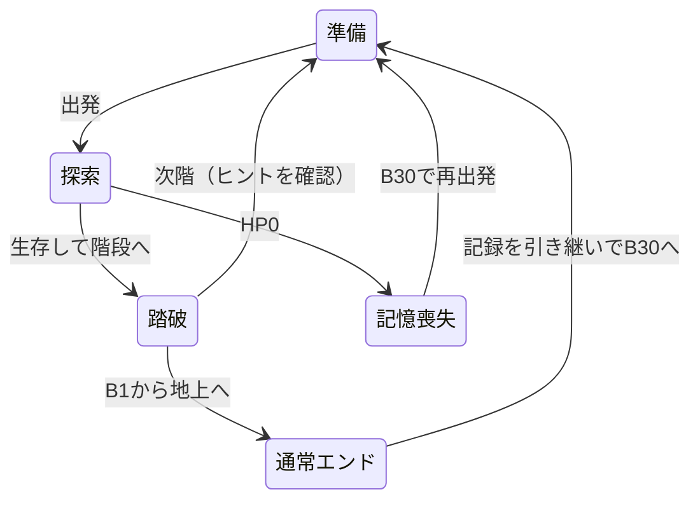

# 骸の旅路 ― システム設計書

更新：2026-10-25。詳細数値と機能の正本は[SPEC.md](SPEC.md)、世界観・企画は[DESIGN.md](DESIGN.md)。

## 構成

| ファイル | 責務 |
| --- | --- |
| data.js | テーマ・敵・装備・11スキルのマスタ |
| field-events.js | 通常30階／TRUE予定50階／手紙B15、区間対応、異変の決定と次階のヒント |
| orders.js | 全19指示の条件・優先順位・枠数・移動先判断。全指示を初期利用可能とする |
| game-engine.js | 探索・戦闘・装備・育成・ステージ生成・イベント発動・セーブ移行 |
| engine.js | エンジン機能の公開入口 |
| skill-tree.js | 4系統の分類とノード座標。指示系統は枠数拡張の指揮のみ |
| debug-tools.js | 階移動・能力変更・装備生成 |
| app.js | 画面の描画、操作、停止、音、自動保存、説明ポップアップ |
| index.html / screens.css | 準備・探索・終了ヒント・図鑑・デバッグの表示 |

## 状態遷移

TRUEの50階構成は定数・案内に反映する。本編・息子との共闘の状態遷移はまだ追加しない。

## フロア生成とヒントの一致

1. シードと内部階番号から `fieldPlan` で異変を一度決定する。地形用の乱数系列とは独立。
2. 5階ごとの区間を選び、部屋と通路を生成する。
3. 開始点・階段、通常敵・泉・宝箱、B15の手紙を配置する。
4. ハウスの場合は開始部屋・階段部屋以外から1室を選ぶ。残りの空き床へ追加敵または罠を置く。霧は地形を変更しない。
5. 踏破時は次階の `fieldPlan` と同じ入力でヒントを作り、`nextHint` に保存する。次階生成時も同じ結果を使う。

プレイヤーが読める危険のヒントと、AIが知る敵・アイテムの座標は分ける。ヒントを理由に未発見位置をAIへ渡さない。

## 異変の状態

- `gimmick`：種類ID、表示名、入室済みフラグ、対象部屋の矩形。
- `enemies[].house`：追加敵の印。対象部屋へ入るまで行動しない。入室時に全追加敵を追跡状態にする。
- `traps[]`：位置、作動済み、発見済み。未発見はマップと経路判断へ渡さず、作動後のみ表示する。
- 霧は `radius` で視界を減らす。地形発見・敵の視認・AIの対象判断・描画で同じ視界判定を使う。
- 作動フラグ、罠、敵、ヒントを通常の保存へ含め、再読み込みで再配置しない。

## ターン処理

再生の祈り → 退避優先判定／隣接攻撃／指示による移動 → アイテム取得・泉 → ハウス入室 → 罠と死亡判定 → 生存敵の行動と死亡判定 → 視界更新 → 階段踏破・報酬・次階ヒント。

踏破は実際の階段座標と一致した場合だけ。死亡後に報酬や次階移動を行わない。

## セーブv6と移行

- 保存キーは維持。`floor` は通常30階の内部番号。`profile` は通常エンド達成・図鑑・周回記録。
- 旧50階の番号は進行割合で30階へ写像し、生成済みの現在階を維持する。新しい異変は次階から導入する。
- 廃止した指示スキルを削除し、その取得段階の旧費用相当を補償。装備・能力・指示列・指揮段階を維持する。
- 手紙箱は新しいB15に整合させる。取得済みの手紙は消さない。
- 変換前は別キーにバックアップし、純粋なコピーを変換する。詳細式と補償の扱いはSPEC第12節。

## 検証方針

全30階の連結性と重複配置、全指示の初期利用と枠数制約、B15条件、次階予告と実生成の一致、追加敵の待機・一斉活動、罠の一回性・死亡順、霧の視界共通性、JSON復帰と旧版移行を検証する。通常エンドまで複数シードで通し実行し、停止不能・報酬重複・進行不能がないことを確認する。
