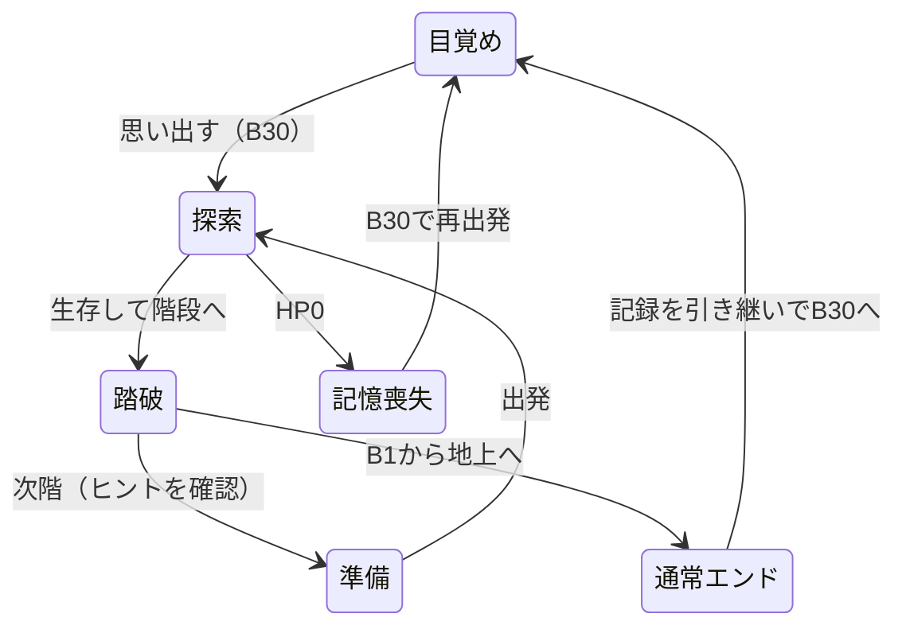

# 骸の旅路 ― システム設計書

更新：2026-10-26。詳細数値と機能の正本は[SPEC.md](SPEC.md)、世界観・企画は[DESIGN.md](DESIGN.md)。

## 構成

| ファイル | 責務 |
| --- | --- |
| data.js | テーマ・敵・装備・7項目のマスタ |
| field-events.js | 通常30階／TRUE予定50階／手紙B15、区間対応、異変の決定と次階のヒント |
| orders.js | 全19指示の条件・優先順位・枠数・移動先判断。全指示を初期利用可能とする |
| map-view.js | 発見済み地形・公開マーカー、グリッド描画、視界に合わせる追従カメラ |
| game-engine.js | 探索・戦闘・装備・育成・ステージ生成・イベント発動・セーブ移行 |
| thought-view.js | intentの自然な独り言字幕への変換 |
| engine.js | エンジン機能の公開入口 |
| skill-tree.js | 本編7項目の3分類一覧。グラフ・ノード座標は持たない |
| debug-tools.js | 階移動・能力変更・装備生成 |
| app.js | 画面の描画、操作、停止、音、自動保存、記憶の取得一覧 |
| index.html / screens.css | 準備・探索・終了ヒント・図鑑・デバッグの表示 |

## 状態遷移

TRUEの50階構成は定数・案内に反映する。本編・息子との共闘の状態遷移はまだ追加しない。

## フロア生成とヒントの一致

1. シードと内部階番号から `fieldPlan` で異変を一度決定する。地形用の乱数系列とは独立。
2. 5階ごとの区間を選び、部屋と通路を生成する。
3. 開始点・階段、通常敵・泉・宝箱、B15の手紙を配置する。B20・B10の場合は早期に固定闘技場生成へ分岐し、乱数による配置を行わない。
4. ハウスの場合は開始部屋・階段部屋以外から1室を選ぶ。残りの空き床へ追加敵または罠を置く。霧は地形を変更しない。
5. 踏破時は次階の `fieldPlan` と同じ入力でヒントを作り、`nextHint` に保存する。次階生成時も同じ結果を使う。

プレイヤーが読める危険のヒントと、AIが知る敵・アイテムの座標は分ける。ヒントを理由に未発見位置をAIへ渡さない。

## 異変の状態

- `gimmick`：種類ID、表示名、入室済みフラグ、対象部屋の矩形。
- `enemies[].house`：追加敵の印。対象部屋へ入るまで行動しない。入室時に全追加敵を追跡状態にする。
- `traps[]`：位置、作動済み、発見済み。トラップハウスは全位置を表示モデルへ渡し、通常罠は地形発見後に表示する。作動前後を色分けする。
- 霧は `radius` で視界を減らす。地形発見・敵の視認・AIの対象判断・描画で同じ視界判定を使う。
- 作動フラグ、罠、敵、ヒントを通常の保存へ含め、再読み込みで再配置しない。

## ターン処理

再生の祈り → 退避優先判定／隣接攻撃／指示による移動 → アイテム取得・泉 → ハウス入室 → 罠と死亡判定 → 生存敵の行動と死亡判定 → 視界更新 → 階段踏破・報酬・次階ヒント。

踏破は実際の階段座標と一致した場合だけ。死亡後に報酬や次階移動を行わない。

## セーブv8と移行

- 保存キーは維持。`floor` は通常30階の内部番号。`profile` は通常エンド達成・図鑑・周回記録。
- 旧50階の番号は進行割合で30階へ写像し、生成済みの現在階を維持する。新しい異変は次階から導入する。
- 廃止した指示スキルを削除し、その取得段階の旧費用相当を補償。装備・能力・指示列・指揮段階を維持する。
- 手紙箱は新しいB15に整合させる。取得済みの手紙は消さない。
- 変換前は別キーにバックアップし、純粋なコピーを変換する。詳細式と補償の扱いはSPEC第12節。

## 検証方針

全30階の連結性と重複配置、全指示の初期利用と枠数制約、B15条件、次階予告と実生成の一致、追加敵の待機・一斉活動、罠の一回性・死亡順、霧の視界共通性、JSON復帰と旧版移行を検証する。通常エンドまで複数シードで通し実行し、停止不能・報酬重複・進行不能がないことを確認する。

## 追加設計（2026-10-25）

- 初期phaseはawakening。開始画面で既存primaryボタンを「思い出す」にして唯一の操作とし、prepare／exploreへ同じボタンを移し替える。通常の準備はB29以降。
- B20とB10はdata.jsのminibossesを共通マスタに追加する。makeBossFloorが固定地形・固定座標を生成。bossフラグを持つ生存敵がいれば階段判定を止める。
- fieldPlanは中ボス階を先に判定し、予告と実配置の一致を保つ。通常罠は異変なしの階で独立乱数から抽選する。
- autoMapModelはseenを元に地形を返す。敵は現在の可視判定、トラップハウスは全罠公開という例外を明示する。主画面とオートマップで同じ罠条件を使う。
- thought-view.jsのthoughtTextがintentを独り言へ変換。app.jsは下部帯のthought-subtitleを現在の字幕1件で更新し、role=statusで通知する。旧Chat履歴・吹き出しの座標計算とDOMは廃止。
- v6→v7は罠表示を更新し、開始前のB30だけawakeningへ移す。現在階の地形は再生成せず、固定中ボス階は次回生成から適用する。

## 本編機能の整理（2026-10-25）

- data.jsからidentify／uncurse／synthesis／bondを削除。app.jsは3分類のカード一覧から直接upgradeを呼ぶ。mendのguard前提は維持し、ツールチップ・ノード描画・素材ダイアログは除去する。
- 装備の生成・取得・デバッグは鑑定済み・非呪いに統一。旧identify／uncurse／synthesizeは互換入口としてfalseを返すだけで、旧スキル段階を注入しても本編操作は成立しない。合成計算は将来案の純粋関数だけ保持。
- normalizeSaveはv7以前をコピーしてv8へ変換。旧4スキルの習得費用を一度返還し、所持・装備中・未開封宝箱を清浄化。入手済み図鑑も公開する。地形・乱数シード・進行は保持。通常ドロップでは旧呪い／未鑑定抽選に相当する乱数を消費してから非呪い・鑑定済みに固定し、他の配置への影響を避ける。
- 手紙のobtainableは通常エンド達成＋未取得のみとし、bondへの依存を廃止（代替条件は仮採用）。TRUE END後の機能解放状態は本編の未実装中には追加しない。

## 追従カメラと探索HUD（2026-10-25）

- cameraForは主人公の補間座標と有効radiusから縦2×ceil(radius)+3マスの投影を返す。app.jsはCanvasをsave→scale→translateで世界座標へ変換し、地形・品物・敵・主人公・攻撃フラッシュを同じカメラで描く。restore後に画面全体の霧を描く。
- miniMapGeometryはセル4／6pxと外周1pxを含む幅・高さ・境界配列を返し、drawMiniMapは地形→グリッド→セル内マーカーの順に描く。表示モデルは従来の発見・可視情報境界を維持。CSS縮小は行わない。
- ステータス帯をマップ直上へ移動し、hud-floor／hud-shardsと既存HP・ATK・DEFをrenderで同期する。字幕はマップ下部の帯で通常の文書フローに置く。ResizeObserverは停止中もカメラとミニマップサイズを再描画する。保存v8とゲームロジックは変更しない。

## Clear表示とヒントの統合（2026-10-26）

- app.jsはphase=clearedの表示をClearとし、既存nextHintまたはnextStageHintの結果をmap-notice内のclear-hintへ描画する。独立next-hint要素と描画・CSSを除去。死亡／通常エンドも同じ終了メッセージ内に補足する。
- 保存内のヒントは変換せず、title先頭の「次は」を表示時のみ除去し、文字列はHTMLエスケープする。ゲーム判定・報酬・v8保存は変更なし。過去ログは維持し、新規成功ログのみClear表記。
- index.htmlから冒頭のsubtitle要素を削除し、CSSで見出し・イントロ・主領域の余白を詰める。

## 感覚・ヘッダー・オプション（2026-10-26）

- data.jsのscoutはcost=10、costStep=8、max=4。priceはcostStep未指定時に従来の4を使う。radiusは4+scout-霧2（下限2）。既存v8の段階・残高は変換せず新効果を適用し、追加請求しない。
- HUDのhud-sightと右カードの視界専用行へ同じradiusを表示。旧ログの通貨名は描画時のみ統一。保存内の文言は変更しない。
- introとscreen-headingを削除し、app.jsも削除要素への参照を除去。brand-groupに英語名と横並びサブタイトル、header-rightにoptions-openを配置。目覚めではgame-iconsだけを隠し、オプションを残す。
- options-dialog内にdebug-openを移動。既存openDialog／finishDialogを再利用し、ネスト中は探索停止と元の停止状態を保つ。すべてのダイアログが閉じた時だけ元へ戻る。

## 上下帯と進行ボタンの整理（2026-10-26）

- dungeon-viewport内にstage-band-top／map-wrap／stage-band-bottomを配置し、上下帯は--stage-band-heightを共用。HUDの末尾へ速度ボタンを移し、記憶の欠片の右に配置する。canvasカメラ座標・地形生成は変更しない。
- 単一のprimaryをフェイズに応じてawakening-start／launch-area／notice-actionsへ移動する。notice-copy（終了文）とnotice-hintだけinnerHTMLを更新し、ボタンを含むnotice-actionsのDOMを再生成しない。これによりハンドラと単一ボタンを維持する。
- pause-toggleは探索中のみ表示する別ボタン。同じクリック処理でpausedを反転し、ひとやすみ／探索を再開を切り替える。中央の休止オーバーレイは廃止。旧restart・prepare-restart・playback・map-bottom・thought-chatは除去する。
- CSSの仮グレーテーマはUIに適用し、区間のCanvas配色は維持。保存形式はv8のまま。

## 最強装備・あきらめる・レターボックス（2026-10-26）

- equipBest(s)はprepare以外を拒否。各slotのgearStatsを比較し、identifiedかつ非呪いの所持品をacquiredOrderで安定化して選択する。現在のスコアを超える場合だけ既存equipを呼び、装備・在庫の個体IDと入手順を保つ。2スロットを処理してもポイントやターンは変えない。
- あきらめるはprepareのUIハンドラからabandon-dialogを開き、確定後、abandonRun(s)→newGame(profile)を使い、表示更新は既存reset(next)を再利用。キャンセルではresetしない。新しい保存形式は追加しない。説明とabandon-runをpreparation-launchへ置き、primaryは従来どおりlaunch-areaの先頭へ移動する。
- dungeon-viewportへletterboxed-viewを追加。上部letterbox内にdungeon-hudを移動し、speedをHUD末尾へ置く。下部は字幕と休止ボタンを保持。区間／TURNはmap-wrap内の下端へ移動。中央のCanvasの寸法・カメラの式は変更しない。

狭い2カラム画面にも対応するため、adventureをinline-sizeコンテナにし、ゲーム枠600px以下では上部を2行・上下96pxへ切り替える。通常は上下56px。letterboxのborderは0とし、主マップとの境界線を描かない。HUDの上下paddingを6px、2行時の行間を4pxに詰めて情報を収める。

探索時のjournalはgrid-column:1／grid-row:2、expeditionはgrid-row:1/3とし、主画面の直下にログを置く。760px以下ではflexのorderをadventure:0、journal:1、expedition:2にする。DOM順もadventure→journal→expeditionへ合わせる。準備時の配置ルールと保存処理は維持する。
